## v0.5.3

### 文件说明 / File Description

MantisZip-0.5.3-Setup-WebSetup.exe 是需要联网才能安装的。MantisZip-0.5.3-Setup-Offline.exe 是离线安装包。MantisZip-0.5.3-Portable.zip 是便携版，解压即用。MantisZip-0.5.3-Portable-Web.zip 是无依赖便携版，需要电脑安装有 .NET 10 运行时才能正常使用。

MantisZip-0.5.3-Setup-WebSetup.exe requires internet during installation. MantisZip-0.5.3-Setup-Offline.exe is a fully offline installer. MantisZip-0.5.3-Portable.zip is the portable version, extract and run. MantisZip-0.5.3-Portable-Web.zip is a dependency-free portable version that requires the .NET 10 runtime to be installed on your computer.

### 更新内容 / Changelog

**启动画面 / Splash Screen**

- 新增**原生启动画面** — 冷启动时在主窗口出现前显示品牌启动画面，覆盖此前「双击后一段时间无任何反馈」的空窗；采用系统原生窗口绘制、不依赖 Avalonia 初始化，低开销且无闪烁（最短显示 300 毫秒，避免一闪而过）；不抢键盘焦点、不进任务栏，关闭后焦点直达主窗口
- Added a **native startup splash** — a branded splash now appears during cold start before the main window is ready, covering the previous "no feedback after double-click" gap; drawn with a native window, independent of Avalonia initialization, low-overhead and flicker-free (minimum 300 ms display so it never just flashes); it does not steal keyboard focus or appear in the taskbar, and focus lands on the main window when it closes
- **应用图标与动态文案** — 启动画面左侧显示应用图标（取自程序内嵌图标，零额外资源），右侧文案随启动方式变化：打开/解压单个压缩包时显示文件名（如「正在打开压缩包 backup.zip」），批量处理时显示数量；超长文件名以省略号截断；支持高 DPI 缩放
- **App icon and dynamic status text** — the splash shows the app icon on the left (taken straight from the executable's embedded icon, no extra assets) and a context-aware text on the right: the file name when opening or extracting a single archive (e.g. "Opening backup.zip"), a count for batch operations; long names are ellipsized; high-DPI aware
- **Windows 11 圆角** — 启动画面在 Windows 11 上使用系统圆角，Windows 10 自动回退为直角
- **Rounded corners on Windows 11** — the splash uses the system rounded-corner style on Windows 11 and falls back to square corners on Windows 10

**交互 / Interactions**

- **菜单快捷键真正生效** — 此前菜单上标注的快捷键（Ctrl+O / Ctrl+N / Ctrl+W / Ctrl+E / F5）**只显示文字、按下无反应**（Avalonia 的 `MenuItem.InputGesture` 仅负责显示，不处理按键）；现已全部注册为全局快捷键
- **Menu shortcuts now actually work** — the shortcuts shown in the menus (Ctrl+O / Ctrl+N / Ctrl+W / Ctrl+E / F5) previously only *displayed* their key text and did nothing when pressed (in Avalonia, `MenuItem.InputGesture` is display-only); they are now registered as real global shortcuts
- **新增常用快捷键** — Ctrl+Shift+L（打开压缩包所在目录）、Ctrl+Shift+E（原地解压）、Ctrl+Shift+T（解压到同名文件夹）、Ctrl+T（测试压缩包完整性）、Ctrl+Shift+A（向压缩包添加文件）、Ctrl+P（显示/隐藏预览面板）、Ctrl+Shift+V（切换文件列表视图）、Ctrl+Shift+I（显示/隐藏信息面板）、Ctrl+Shift+C（复制条目完整路径）、Ctrl+,（设置）
- **New common shortcuts** — Ctrl+Shift+L (open archive location), Ctrl+Shift+E (extract here), Ctrl+Shift+T (extract to folder of the same name), Ctrl+T (test archive integrity), Ctrl+Shift+A (add files to archive), Ctrl+P (toggle preview panel), Ctrl+Shift+V (cycle file list view), Ctrl+Shift+I (toggle info panel), Ctrl+Shift+C (copy full path of the selected entry), Ctrl+, (settings)
- **文件选择器面板标签可记住或固定** — 左侧「路径来源」面板（收藏 / 历史 / 窗口 / 目录树）此前每次打开都回到「收藏」，常用目录每次都要重新点一下；现在默认**记住上次使用的标签**，也可在 设置 → 路径 中改为**固定**某个标签（固定后即使用过程中切换过，下次打开仍回到该标签）。设置里的「默认路径优先级」一并移到「路径」页与它相邻
- **File picker panel tab can be remembered or pinned** — the source panel on the left of the file picker (Favorites / History / Windows / Folders) used to reset to "Favorites" every time, so frequently used folders had to be re-selected each session; it now **remembers the last used tab** by default, and you can **pin** a specific tab under Settings → Paths (once pinned, the picker always opens on that tab even if you switched tabs during the previous session). The "Default path priority" block moved onto the same Paths page
- **进度窗口完成后停止计时并给出统计摘要** — 此前结束后「已用时间」仍在增长，看不到实际耗时；现在进入完成 / 失败 / 取消任一终态即冻结为**最终耗时**，并在状态行下方显示一组统计：处理文件数（含跳过、出错）、生成或解压的压缩包数（批量中有失败时显示「成功 n / 共 m」）、用时、平均速度，以及原始大小 → 输出大小与压缩率（解压时显示解压后总大小）；没有数据的行自动省略，状态行的复制按钮会把摘要一并复制
- **Progress window freezes the timer and shows a completion summary** — the elapsed time used to keep counting after the operation finished, so the real duration was unreadable; reaching a final state (completed / failed / cancelled) now **freezes the final elapsed time** and prints a summary under the status line: files processed (plus skipped and failed), archives created or extracted ("n of m" when a batch has failures), elapsed time, average speed, and original → output size with the compression ratio (extracted total size for extraction). Lines without data are omitted, and the status-line copy button copies the summary along with the status text
- **进度窗口状态行按阶段显示** — 此前状态行只写一句「正在压缩/解压」，看不出卡在哪个环节；现在按引擎上报的阶段显示「正在扫描文件… / 正在读取压缩包… / 正在压缩… / 正在解压… / 正在收尾… / 正在校验…」，扫描阶段进度条改为滚动并在文件计数行显示「已发现 N 个文件」，正式压缩与逐条目写入能够区分开
- **Progress window status line now names the current phase** — the status line used to be a static "Compressing…" / "Extracting…" with no hint of what the engine was actually doing; it now follows the phase reported by the engine (scanning files / reading archive / compressing / extracting / finalizing / verifying), the progress bar scrolls while scanning and the file counter shows how many files have been found, and the write-out stage is distinguishable from the scan stage
- **繁体中文「分卷大小」术语修正** — 压缩设置里的「分磁碟區大小 / 不分磁碟區」把**压缩包分卷**误译成硬盘的「磁盘区」（disk volume / 磁盘分区）；现依繁中实用用语改为「**分割檔大小 / 不分割**」（对齐 WinRAR 繁中「切成分割檔，大小」），并同步修正自适应压缩、多线程压缩说明文字中的「分卷」用词
- **Traditional Chinese split-size wording corrected** — the compression settings labeled the archive split size with "磁碟區", which actually means a disk volume/partition rather than an archive volume; it now reads "**分割檔大小 / 不分割**" following common Taiwan usage (matching WinRAR's Traditional Chinese "切成分割檔，大小"), and the adaptive / multithreaded compression help text was aligned to the same wording
**性能 / Performance**

- **启动速度优化** — ① 主题重复加载消除：应用/切换主题时同主题直接跳过解析、图标字典跨主题复用，实测启动再降约 100ms（同时修复旧实现「先清空后加载」在加载失败时界面无样式的缺陷）；② 设置读取进程级缓存：冷启动只读盘一次，运行期重开窗口/对话框不再反复读盘反序列化，72 处调用点全部受益
- **Faster startup** — ① eliminated duplicate theme parsing: applying a theme now skips parsing entirely when it is already active, and the icon dictionary is reused across themes, measured ~100 ms faster startup (this also fixes the old "clear-then-load" sequence that left the UI unstyled when loading failed); ② process-level settings cache: the cold start reads from disk a single time, and reopening windows/dialogs at runtime no longer re-reads and re-deserializes the file, benefiting all 72 call sites
- **启动速度再优化（ReadyToRun）** — 发布版启用 ReadyToRun（仅预编译应用主程序集），应用初始化与窗口 XAML 构建更快，实测冷启动缩短约 0.1 秒；安装包体积增加约 4 MB
- **Faster startup (ReadyToRun)** — release builds now use ReadyToRun (precompiling the app's main assembly only), speeding up app initialization and window XAML construction; measured cold start about 0.1 s faster, with the installer growing by roughly 4 MB
- **主窗口界面按需加载** — 启动时不再一次性构建全部控件：默认隐藏的过滤栏、整个压缩包内容区（目录树 / 文件列表 / 预览面板 / 拖拽添加覆层）与菜单子项改为首次使用时才创建，实测窗口界面构建阶段缩短约 0.15 秒；打开压缩包时内容区即刻呈现，功能与布局完全不变
- **Main window UI is now built on demand** — the app no longer constructs every control at launch: the filter bar (hidden by default), the entire archive content area (folder tree, file list, preview panel, drag-and-drop overlay) and the menu sub-items are created the first time they are actually needed, measurably shortening the window's UI construction phase by about 0.15 s; the content area appears immediately when an archive is opened, with features and layout unchanged

**压缩加速 / Compression Speed-ups**

- 新增**魔数检测** — 自适应压缩可读取文件头识别真实格式：对改名、无扩展名或扩展名与内容不符的文件（例如 `.dat` 实为 JPEG），识别为已压缩格式时同样按「仅存储」处理，不再二次压缩；仅对 64 KB 以上的大文件生效，会略微增加压缩耗时
- Added **magic-number detection** — adaptive compression can now read file headers to identify the real format: for renamed files, extension-less files, or files whose extension does not match their content (e.g. a `.dat` that is actually a JPEG), already-compressed content is stored as-is instead of being compressed again; it applies only to files of 64 KB and above, and slightly increases compression time
- **自定义自适应规则生效** — 「自适应规则」中的用户自定义规则现在对所有格式生效（此前即使启用多线程压缩也不生效），且优先级高于内置的「已压缩格式仅存储」判定；可按格式指定压缩级别（仅存储 / 快速 / 标准 / 最大 / 跟随全局 / 自定义）。**注意**：多线程压缩按分组批量压缩、组内统一使用所选压缩级别，因此规则中「指定压缩级别」在大批量压缩时不生效（「仅存储」类始终生效）；小目录、加密包、分卷等走串行路径时规则全部生效。
- **Custom adaptive rules now take effect** — rules under "Adaptive Rules" now apply to every format (previously they were ignored even when Multithreaded Compression was enabled) and take priority over the built-in "store already-compressed formats" rule; you can assign a compression level per format (Store / Fast / Normal / Max / follow global / custom). **Note**: the multithreaded path compresses in groups and uses one compression level per group, so rules that specify a compression level do not take effect for large batches ("Store" rules always do); rules work fully when the serial path is used (small folders, encrypted archives, split archives).
- **默认规则集调整** — 默认的「图片类 / 视频类 / 音频类 / 压缩包类」规则不再包含 SVG、TAR、WAV 等未压缩格式（这些格式用 Deflate 压缩仍有明显收益），仅确属已压缩的格式按「仅存储」处理
- **Adjusted default rule set** — the default "Image / Video / Audio / Archive" rules no longer include uncompressed formats such as SVG, TAR and WAV (Deflate still shrinks them noticeably); only genuinely compressed formats are stored as-is

**修复 / Fixes**

- **「数据条」开关现在生效** — 「视图」菜单下的「数据条」开关此前按下后没有任何变化（数据条既不出现也不消失）：切换时只翻转了内部状态，却未重算或清零各条目决定数据条长度的比例值。现已修正：开启时重算比例、关闭时清零比例，并且不会重建文件列表、不会丢失当前选中项
- **The "Data Bars" switch now works** — the switch under the View menu previously had no effect at all (the bars neither appeared nor disappeared): toggling it only flipped an internal flag without recomputing or clearing the per-entry ratios that determine the bar length. It now recomputes the ratios when switched on and clears them when switched off, without rebuilding the file list or losing the current selection
- **目录行的数据条底色可区分** — 开启「目录基线」后，目录行与文件行的底色此前完全相同（无法区分目录与文件）：从 WPF 迁移到 Avalonia 时丢失了按目录/文件切换底色的逻辑。现已修正：大小与压缩后大小两列中，目录行使用更饱和的底色、文件行保持淡色，并随浅色/深色主题自动适配
- **Directory rows are now colored differently** — with "Separate directory baseline" enabled, directory rows used exactly the same bar color as file rows, so the two were indistinguishable: the WPF color-switching logic was lost during the Avalonia port. In the size and compressed-size columns, directory rows now use a more saturated shade while file rows keep the light shade, following the light/dark theme automatically

## v0.5.2

### 文件说明 / File Description

MantisZip-0.5.2-Setup-WebSetup.exe 是需要联网才能安装的。MantisZip-0.5.2-Setup-Offline.exe 是离线安装包。MantisZip-0.5.2-Portable.zip 是便携版，解压即用。MantisZip-0.5.2-Portable-Web.zip 是无依赖便携版，需要电脑安装有 .NET 10 运行时才能正常使用。

MantisZip-0.5.2-Setup-WebSetup.exe requires internet during installation. MantisZip-0.5.2-Setup-Offline.exe is a fully offline installer. MantisZip-0.5.2-Portable.zip is the portable version, extract and run. MantisZip-0.5.2-Portable-Web.zip is a dependency-free portable version that requires the .NET 10 runtime to be installed on your computer.

### 更新内容 / Changelog

**新预览格式 / New Preview Formats**

- 音频预览新增 **MP3 / FLAC 内嵌封面显示** — 直接读取 ID3 标签（MP3）与 PICTURE 块（FLAC）中的内嵌封面图并居中展示；无封面时回退显示标题/艺术家大字
- Added **embedded cover art display for MP3 / FLAC audio preview** — reads the embedded cover image from the ID3 tag (MP3) and the PICTURE block (FLAC) and shows it centered; falls back to a large title/artist text when no cover is present

**交互 / Interactions**

- **菜单快捷键真正生效** — 此前菜单上标注的快捷键（Ctrl+O / Ctrl+N / Ctrl+W / Ctrl+E / F5）**只显示文字、按下无反应**（Avalonia 的 `MenuItem.InputGesture` 仅负责显示，不处理按键）；现已全部注册为全局快捷键
- **Menu shortcuts now actually work** — the shortcuts shown in the menus (Ctrl+O / Ctrl+N / Ctrl+W / Ctrl+E / F5) previously only *displayed* their key text and did nothing when pressed (in Avalonia, `MenuItem.InputGesture` is display-only); they are now registered as real global shortcuts
- **新增常用快捷键** — Ctrl+Shift+L（打开压缩包所在目录）、Ctrl+Shift+E（原地解压）、Ctrl+Shift+T（解压到同名文件夹）、Ctrl+T（测试压缩包完整性）、Ctrl+Shift+A（向压缩包添加文件）、Ctrl+P（显示/隐藏预览面板）、Ctrl+Shift+V（切换文件列表视图）、Ctrl+Shift+I（显示/隐藏信息面板）、Ctrl+Shift+C（复制条目完整路径）、Ctrl+,（设置）
- **New common shortcuts** — Ctrl+Shift+L (open archive location), Ctrl+Shift+E (extract here), Ctrl+Shift+T (extract to folder of the same name), Ctrl+T (test archive integrity), Ctrl+Shift+A (add files to archive), Ctrl+P (toggle preview panel), Ctrl+Shift+V (cycle file list view), Ctrl+Shift+I (toggle info panel), Ctrl+Shift+C (copy full path of the selected entry), Ctrl+, (settings)
**性能 / Performance**

- **自适应压缩体系** — 压缩对话框与设置新增「加速」选项卡，压缩策略收敛为两个独立开关：**多线程压缩**（可压缩文件走 7z 多线程并发压缩；ZIP 场景由 N 组并行管线承接）与**自适应压缩**（已压缩内容自动转为仅存储、不再重复压缩，仅存储作用范围的格式列表可自定义维护）；两个开关可任意组合独立生效
- **Adaptive compression system** — the compress dialog and Settings gain a "speed-up" tab; the compression strategy converges into two independent switches: **multithreaded compression** (compressible files are compressed concurrently via 7z multithreading, with ZIP routed through the N-group parallel pipeline) and **adaptive compression** (already-compressed content is automatically stored without re-compression, over a customizable store-format list); the two switches combine freely and each works on its own
- **ZIP N 组并行压缩** — 开启「多线程压缩」后 ZIP 经 N 组并行管线压缩：文件按 LPT 贪心算法分组，各组 7z 多线程并发压缩，最后 copy-mode 合并进最终 ZIP（不重压缩）；并行组数**自动按 CPU 核数决策**（约取核数值并限制在 4–16 区间），无需手动设置；总大小超过 ZIP32 上限（约 4GB）时自动禁用并提示
- **ZIP N-group parallel compression** — with "multithreaded compression" enabled, ZIP compression runs through an N-group parallel pipeline: files are split by LPT greedy grouping, each group is compressed concurrently via 7z multithreading, then merged into the final ZIP via copy mode (no re-compression); the group count is **resolved automatically from the CPU core count** (roughly the core count, clamped to 4–16) and needs no manual setting; automatically disabled with a notice when the total size exceeds the ZIP32 limit (~4GB)
- 
- **智能并行解压** — 解压线程数改为自动决策：智能模式按磁盘类型给出默认值（SSD / HDD 不同），≥1GB 的大包先用小样本预测试选优；解压对话框线程数默认 0=自动；设置窗口解压页新增并行解压卡片（全局开关 / 智能并行 / SSD·HDD 线程数 / 大包预测试）
- **Smart parallel extraction** — the extraction thread count is now resolved automatically: smart mode picks disk-type-aware defaults (different for SSD vs HDD), and archives ≥1GB run a small-sample pre-test to pick the optimal degree; the extract dialog defaults to thread count 0 = auto; Settings gains a parallel-extraction card (global toggle / smart mode / SSD & HDD thread counts / large-archive pre-test)
- 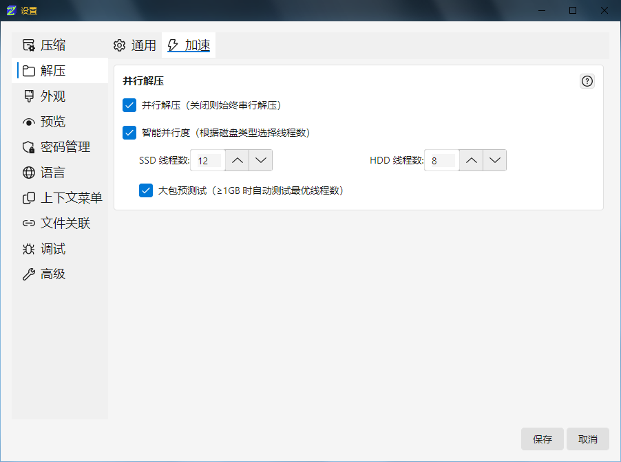
- **启动速度优化** — 预览面板控件树改为延迟实例化（首帧后空闲预取 + 首次预览兜底），实测整体启动耗时降低约 9%，预览面板构造开销降低约 98%
- **Faster startup** — the preview panel's control tree is now instantiated lazily (idle-time prefetch after the first frame, with a fallback on first preview); measured overall startup time down ~9% and preview-panel construction cost down ~98%

**进度窗口 / Progress Window**

- **统计卡三行结构** — 「完整」信息量下 6 张统计卡重构为三行（图标+标题 / 文件数量 / 文件大小）；已处理卡改纯计数（去掉与总大小卡重复的 N/M 分母）；新增跳过 / 失败 / 已覆盖的终态字节累加统计；缺数据显示「—」
- **Three-row statistics cards** — at "full" info density the six statistics cards are restructured into three rows (icon+title / file count / file size); the processed card shows a pure count (dropping the N/M denominator that duplicated the total-size card); new terminal byte accumulators for skipped / failed / overwritten entries; missing data shows a dash
- 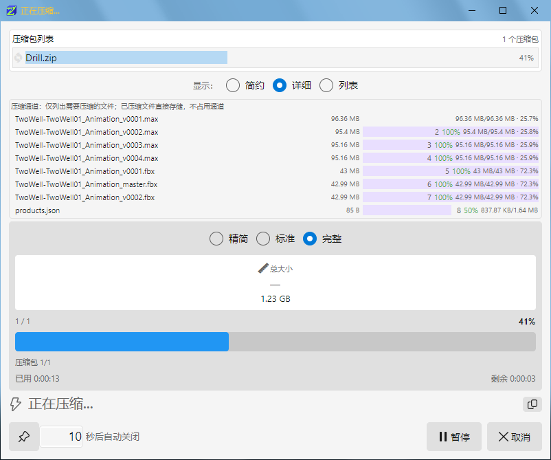
- **通道行左右分组 + 实时压缩率** — 通道行重构为左右两区：左=单文件域（路径中间省略两列 + 文件名恒完整显示 + 文件大小），右=批次域（批序号 / 批进度底纹线 / 合并百分比），批进度底纹替代独立进度条；列表模式新增「压缩后大小 (率)」列（如 `600 KB (50%)`），ZIP 压缩时统计卡区还显示整体压缩汇总
- **Channel rows regrouped with live compression ratios** — each channel row is split into a file area on the left (two middle-ellipsized path columns + always-complete file name + file size) and a batch area on the right (batch index / batch progress underline / merged percentage), replacing separate batch progress bars; list mode gains a "compressed size (ratio)" column (e.g. `600 KB (50%)`), and ZIP compression also shows an overall compression summary
- 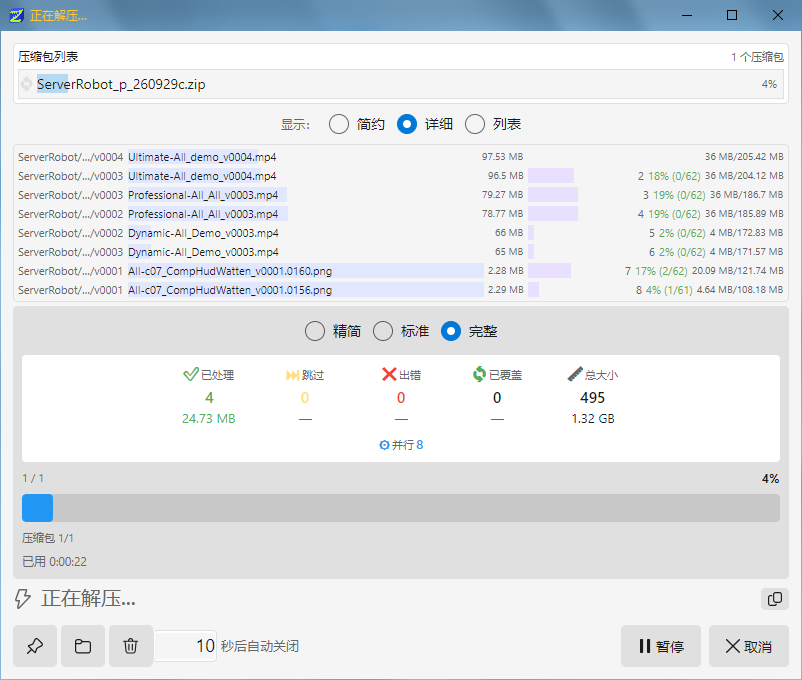
- **速度与剩余时间全格式可用** — 7z / TAR / GZ 的解压、压缩、删除全路径按真实字节上报进度（此前仅 ZIP），所有格式的速度（B/s）与 ETA 一致生效
- **Speed and ETA now work for every format** — 7z / TAR / GZ extraction, compression and deletion now report true byte-level progress (previously ZIP-only), so speed (B/s) and ETA are consistent across all formats
- **状态行 + 失败明细分层 + 自动关闭倒计时** — 状态行下移到信息区下方（可复制）并带六态状态图标；错误摘要红（整包异常）/ 黄（逐条目跳过）分层显示；关闭逻辑统一（出现错误时自动「钉住」不自动关）；自动关闭延迟可配置（3–60 秒）且倒计时盒常显；「测试压缩包」结果写入窗口状态行与错误摘要；解压完成后可在按钮行直接选择「移入回收站」/「打开文件夹」
- **Status line, layered errors and auto-close countdown** — the status line moved below the info section (copyable) with a six-state icon; error summaries are layered red (archive-level) / yellow (per-entry skips); the close chain is unified (errors auto-pin the window); the auto-close delay is configurable (3–60s) with an always-visible countdown box; "test archive" results are written into the status line and error summary; after extraction you can choose "recycle bin" / "open folder" directly from the button row
- 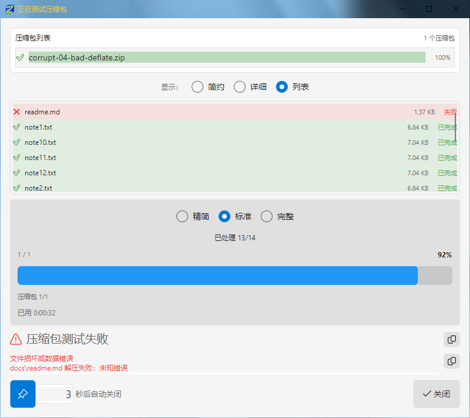
- **显示偏好持久化 + 语言即时刷新** — 内容模式（简洁 / 详细 / 列表）、信息量分级与窗口宽度均记住选择（默认「详细 / 中」）；任务运行中切换语言即时刷新全部文案
- **Persisted display preferences + instant language switch** — content mode (simple / detailed / list), info density and window width are remembered (default: detailed / medium); switching language mid-operation refreshes all texts instantly

**交互 / Interactions**

- 压缩端新增**「文件冲突默认策略」**（对齐解压端）— 可选每次询问 / 覆盖 / 追加 / 自动重命名 / 跳过，设置窗口与压缩对话框均可配置；非「每次询问」时直接按策略执行、不再弹窗
- Added a **default file-conflict strategy for compression** (matching the extract side) — choose ask-each-time / overwrite / add / auto-rename / skip, configurable in both Settings and the compress dialog; anything other than "ask each time" is applied directly without a prompt
- 解压设置窗口新增**「解压后将原压缩包移到回收站」勾选项** — 默认读取全局设置，勾选仅本次解压生效、不写回设置
- The extract settings dialog gained a **"move the original archive to the Recycle Bin after extraction" checkbox** — defaults to the global setting; the choice applies to this extraction only and is not written back
- 7z **字典大小 / 固实块大小支持自定义 MB 输入** — 字典预设从 6 项扩至 11 项（最大 8GB，突破此前 2GB 上限），并支持手动输入任意 MB 值；固实块大小同步支持自定义
- 7z **dictionary size and solid block size now accept custom MB input** — dictionary presets extended from 6 to 11 (up to 8GB, breaking the previous 2GB cap) with free-form MB entry; solid block size supports custom input as well
- 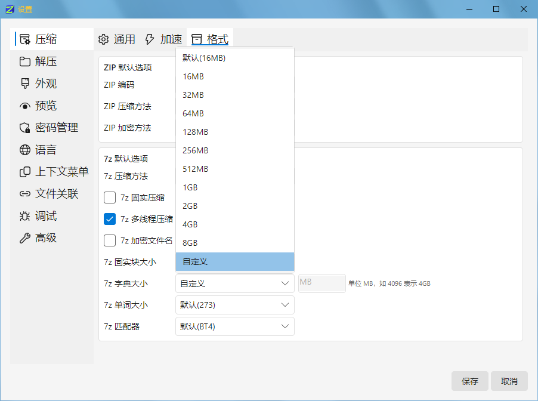
- **帮助弹窗全面 Markdown 化** — 压缩加速 / 并行解压 / 密码管理器 / 日志隐私四处帮助统一改为 Markdown 驱动渲染（支持表格、文本可选中复制），帮助按钮统一为问号图标
- **Help dialogs fully Markdown-driven** — the four help windows (compression speed-up / parallel extraction / password manager / log privacy) now render from localized Markdown (tables supported, text selectable and copyable); help buttons unified as a question-mark icon
- 

**修复 / Fixes**

- 修复**预览窗格宽度缩水** — 拖动分隔条调整预览面板尺寸后，重新打开应用时面板会缩回最小；原因是尺寸记忆只记录了固定像素值，未保存过布局时拖出的是比例（Star）尺寸而被丢弃。现同时记录像素与比例两种尺寸并持久化，恢复后比例尺寸随窗口缩放、像素尺寸保持固定
- Fixed **the preview pane shrinking to its minimum width** — after resizing the preview panel by dragging the splitter, reopening the app collapsed it back to the minimum; the cause was that the size memory only stored fixed pixel values and discarded the proportional (Star) size produced when no layout had been saved yet. It now records and persists both pixel and proportional sizes; on restore, proportional sizes scale with the window while pixel sizes stay fixed
- 修复**加密压缩包（RAR/7z）「测试压缩包」静默失败** — 此前加密包测试只从会话缓存读密码，无会话密码时测试接口快速返回失败，状态栏仅显示「测试失败」且无任何提示。现测试前先对齐解压/打开流程解析密码：会话缓存 → 密码库自动匹配 → 密码对话框（含快速验证，错密码循环重试）；取消时提示「已取消 - 需要密码」并中止，不再假失败
- Fixed **silent "Test archive" failure on encrypted RAR/7z archives** — the test previously read the password only from the session cache; with no session password the test API quickly returned false and the status bar showed only "test failed" with no prompt. The test now resolves the password exactly like open/extract first: session cache → password library auto-match → password dialog (with quick verification and retry on wrong password); cancelling shows "Cancelled - password required" and aborts instead of falsely failing
- 修复**测试压缩包时进度条不动** — 底层 `TestArchiveAsync` 此前在 `Check()`（=7z.dll 整包提取校验语义）阶段不订阅任何进度事件，同时校验完后还冗余地对每个条目再解压一次（约 2 倍工作量）。现改为消费校验阶段的 `FileExtractionFinished` 事件逐条目上报进度，并删除冗余的逐条目二次解压；实测 130MB 未加密 RAR 测试由约 1.4s 降至约 0.8s，且加密/未加密 RAR、7z 测试均实时显示进度
- Fixed **the progress bar not moving during "Test archive"** — `TestArchiveAsync` previously subscribed to no progress events during `Check()` (the 7z.dll full-extraction verify), and afterwards redundantly extracted every entry again (~2x the work). It now reports per-entry progress from the `FileExtractionFinished` events raised during verification and drops the redundant per-entry re-extraction; measured 130MB unencrypted RAR test dropped from ~1.4s to ~0.8s, and both encrypted and unencrypted RAR and 7z tests now show live progress
- 修复**非加密压缩包误报「密码匹配」** — 密码快速验证在压缩包不含加密条目时对任意密码都返回成功，导致非加密包被误判为已匹配密码；现无加密条目时直接短路返回，不再误报
- Fixed **false "password matched" reports on non-encrypted archives** — quick password verification returned success for any password when the archive had no encrypted entries, misclassifying non-encrypted archives; it now short-circuits when there are no encrypted entries
- 修复**损坏 ZIP 被静默通过** — 引擎此前用 SharpCompress 的裸流读取条目（不校验 CRC），导致「数据被改动但仍可解码」的损坏条目（如 stored 条目字节翻转、CRC 字段错）在「测试压缩包」与解压时均不报错、静默解出错误内容。现改走官方 CRC 校验路径：损坏条目在测试中判为失败，解压时逐条目报告**「数据损坏（CRC 校验失败）」**并删除已写出的损坏文件、不再中止整批；加密包（含 WinZip AES AE-2）、CRC 不可用等边界由官方路径自动跳过，不会误报
- Fixed **corrupted ZIPs passing silently** — the engine previously read entries through SharpCompress's raw stream (which does not verify CRC), so damaged-but-decodable entries (e.g. a bit-flipped stored entry, or a wrong CRC field) passed both "test archive" and extraction with no error and silently produced wrong output. It now uses the official CRC-validating path: damaged entries fail the test and, on extraction, are reported per-entry as **"Data corruption (CRC check failed)"** with the corrupt output deleted and the rest of the batch continuing; edge cases such as encrypted archives (incl. WinZip AES AE-2) and unavailable CRC are skipped automatically by the official path, so there are no false positives
- 压缩/解压**出错信息全面本地化与分层** — 整包级错误（文件未找到 / 无权限 / 目录不存在 / 压缩包损坏 / 已加密）不再直接弹原始异常文本，改为映射到本地化文案，原始异常信息保留在可展开的详情中；逐条目失败原因（损坏 / 加密 / 读取失败等）会同时写入状态行与失败明细；弹窗与状态行不再出现「操作失败：」等冗余前缀。含两个状态行修复：测试校验完成后状态行不再一直卡在「正在准备…」，出错后状态行不再被反复覆盖刷新
- **Localized and layered error messages for compression / extraction** — archive-level errors (file not found / access denied / directory missing / corrupted archive / encrypted) no longer surface as raw exception text: they are mapped to localized messages, with the original exception kept in an expandable detail; per-entry failure reasons (corrupted / encrypted / read failure, etc.) are written to both the status line and the failure list; redundant prefixes such as "Operation failed:" are gone from prompts and status lines. Includes two status-line fixes: it no longer stays stuck at "preparing…" after verification completes, and error states are no longer overwritten by repeated refreshes
- 修复**损坏的 7z / RAR 压缩包被误判为「已加密」** — 此前损坏包（头部结构异常）会触发「请输入密码」提示，输入正确密码也无济于事；现按头部结构区分「损坏」与「加密」，损坏包给出正确的损坏提示
- Fixed **corrupted 7z / RAR archives being misclassified as encrypted** — damaged archives (with a broken header structure) used to trigger the "enter password" prompt, which never succeeded even with the correct password; header-structure inspection now distinguishes "corrupted" from "encrypted" and reports the actual damage
- 修复**Windows 文件关联失效系列问题** — 关联注册统一收口到 RegistryHost（不再散落多处直连注册表导致部分写字段丢失）；修复升级安装后残留悬空的 UserChoice 选择导致关联被系统拒绝；修复关联后文件图标缺失（补 DefaultIcon）；卸载/重装时清理旧版本遗留的 ProgId；启动时自动检测并修复被第三方软件篡改的关联项；写注册表后广播 SHChangeNotify， Explorer 图标与关联即时刷新、无需重启或重启 Explorer；卸载时通过 RunOnce 钩子清理注销后残留的注册数据
- Fixed **a series of Windows file-association failures** — association registry writes are now funneled through a single RegistryHost (previously scattered direct writes could drop sub-keys); dangling UserChoice entries left behind by upgrades no longer make the system reject the association; a missing DefaultIcon is now supplied so associated files keep their icon; legacy ProgIds from old installs are cleaned up on uninstall/reinstall; associations tampered with by third-party tools are auto-detected and repaired at startup; SHChangeNotify is broadcast after registry writes so Explorer refreshes icons and associations immediately, without restarting the app or Explorer; a RunOnce hook cleans up leftover registry data after uninstall
- CLI 压缩/解压命令**退出路径统一收口 AppShutdown** — 此前 12 条直接退出路径各自收尾，可能出现日志未落盘或进程驻留；现统一走关停流程后再退出
- CLI compress/extract commands now **exit through the unified AppShutdown path** — 12 direct-exit paths previously did their own teardown, which could leave logs unflushed or the process lingering; all exits now go through the unified shutdown flow
- 修复**未打开压缩包时拖入文件/目录后点「压缩」无反应** — 拖入路径能预填进压缩对话框，但点「压缩」关闭对话框后没有接上执行管道，压缩静默不执行；现拖入压缩与「新建压缩包」走同一执行链（选项拷贝回传 → 构建压缩请求 → 进度窗口 → 冲突/错误弹窗），行为完全一致
- Fixed **clicking "Compress" after dropping files/folders into the main window doing nothing** — dropped paths did pre-fill the compress dialog, but nothing was wired up after clicking "Compress" and closing it, so the compression silently never ran; drag-in compression now goes through the exact same execution chain as "New Archive" (dialog options copied back → request built → progress window → conflict/error prompts)

**依赖升级 / Dependency Upgrades**

- SixLabors.ImageSharp 安全升级 3.1.5 → 4.1.3，并覆盖 SQLitePCLRaw 原生库至 3.53.3
- Security-upgraded SixLabors.ImageSharp from 3.1.5 to 4.1.3 and overlaid SQLitePCLRaw native binaries at 3.53.3

## v0.5.1

### 文件说明 / File Description

MantisZip-0.5.1-Setup-WebSetup.exe 是需要联网才能安装的。MantisZip-0.5.1-Setup-Offline.exe 是离线安装包。MantisZip-0.5.1-Portable.zip 是便携版，解压即用。MantisZip-0.5.1-Portable-Web.zip 是无依赖便携版，需要电脑安装有 .NET 10 运行时才能正常使用。

MantisZip-0.5.1-Setup-WebSetup.exe requires internet during installation. MantisZip-0.5.1-Setup-Offline.exe is a fully offline installer. MantisZip-0.5.1-Portable.zip is the portable version, extract and run. MantisZip-0.5.1-Portable-Web.zip is a dependency-free portable version that requires the .NET 10 runtime to be installed on your computer.

### 更新内容 / Changelog

**新预览格式 / New Preview Formats**

- 新增 **APNG 动画预览** — 通过 `acTL` 块魔数检测识别，与 GIF 统一走动画通道，支持逐帧播放与透明背景棋盘格
- Added **APNG animated preview** — detected via the `acTL` chunk magic number, handled uniformly with GIF in the animation path; supports frame-by-frame playback and the transparency checkerboard
- 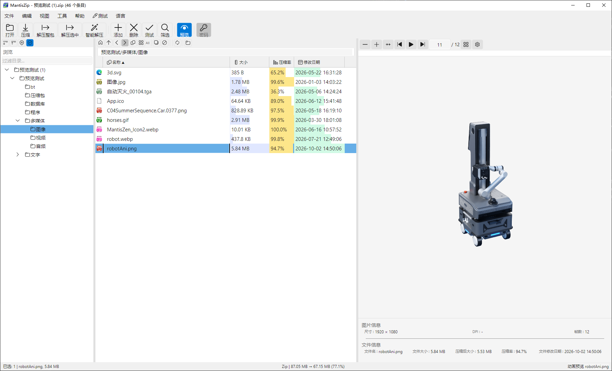
- 新增 **TGA 预览** — 使用 ImageSharp 解码，并修复了红蓝通道交换导致颜色错误的问题
- Added **TGA preview** — decoded via ImageSharp, with a fix for swapped red/blue channels that caused incorrect colors
- 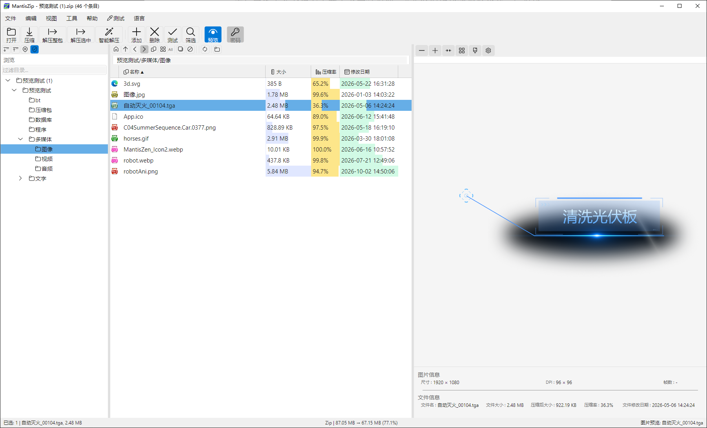

**交互 / Interactions**

- **菜单快捷键真正生效** — 此前菜单上标注的快捷键（Ctrl+O / Ctrl+N / Ctrl+W / Ctrl+E / F5）**只显示文字、按下无反应**（Avalonia 的 `MenuItem.InputGesture` 仅负责显示，不处理按键）；现已全部注册为全局快捷键
- **Menu shortcuts now actually work** — the shortcuts shown in the menus (Ctrl+O / Ctrl+N / Ctrl+W / Ctrl+E / F5) previously only *displayed* their key text and did nothing when pressed (in Avalonia, `MenuItem.InputGesture` is display-only); they are now registered as real global shortcuts
- **新增常用快捷键** — Ctrl+Shift+L（打开压缩包所在目录）、Ctrl+Shift+E（原地解压）、Ctrl+Shift+T（解压到同名文件夹）、Ctrl+T（测试压缩包完整性）、Ctrl+Shift+A（向压缩包添加文件）、Ctrl+P（显示/隐藏预览面板）、Ctrl+Shift+V（切换文件列表视图）、Ctrl+Shift+I（显示/隐藏信息面板）、Ctrl+Shift+C（复制条目完整路径）、Ctrl+,（设置）
- **New common shortcuts** — Ctrl+Shift+L (open archive location), Ctrl+Shift+E (extract here), Ctrl+Shift+T (extract to folder of the same name), Ctrl+T (test archive integrity), Ctrl+Shift+A (add files to archive), Ctrl+P (toggle preview panel), Ctrl+Shift+V (cycle file list view), Ctrl+Shift+I (toggle info panel), Ctrl+Shift+C (copy full path of the selected entry), Ctrl+, (settings)
**性能 / Performance**

- **ZIP 并行解压** — 多实例并行 + 批次复用（Round-Robin 分批 + 实例复用），解压缓冲区 256KB → 4MB
- **Parallel ZIP extraction** — multi-instance parallelism with batch reuse (Round-Robin batching + instance reuse); extraction buffer raised from 256KB to 4MB
- 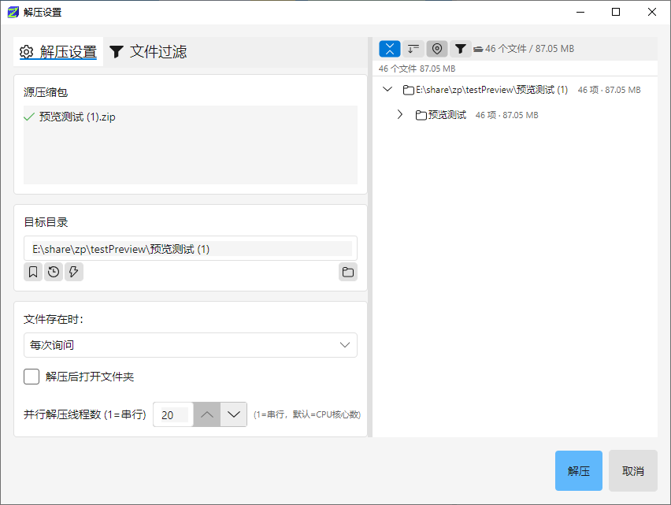
- **7z 多线程压缩（`mt=on`）** — 实测 100 × 1MB 随机数据加速 **4.63x**，压缩对话框与设置窗口双入口开关
- **7z multithreaded compression (`mt=on`)** — measured 4.63x speedup on 100 × 1MB random data; toggles available in both the compress dialog and Settings
- 新增**并行解压线程数**设置项（1–16，默认随 CPU 核数，`1` 为串行回退）
- Added a **parallel extraction thread count** setting (1–16, defaults to CPU core count; `1` falls back to serial)

**交互 / Interactions**

- 解压目标目录选择器新增**左下通用参数区**，首个参数项为**「保留完整路径」**开关 — 修复「预览所见 ≠ 实际落盘」：此前对话框只返回路径，调用方拿到路径后回头独立读设置，用户在预览阶段无法表达意图；现改为强类型 `ExtractPickResult` 贯穿两个有对话框的消费点
- The extract folder picker gained a **generic options region** at the bottom left, whose first option is a **"Preserve full path"** toggle — fixing the "preview ≠ actual extraction" mismatch: the dialog previously returned only a path and callers re-read the setting afterwards, so the user could not express intent while previewing; a strongly-typed `ExtractPickResult` now carries it through both dialog-driven call sites
- 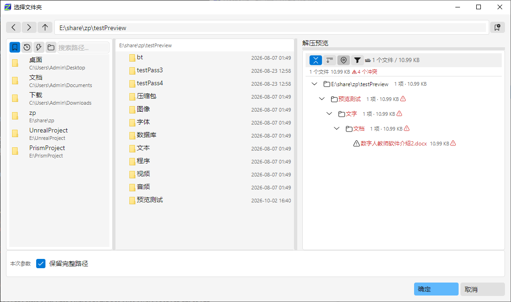
- 自定义文件选择器新增**自定义文件类型**与**建议文件名**，添加文件支持选择文件夹，密码管理器导入导出改用自定义选择器
- The custom file picker now supports **custom file types** and **suggested file names**; adding files accepts folders, and password manager import/export moved to the custom picker
- 拖拽解压目标检测失败时改用带解压预览的自定义对话框兜底
- Drag extraction now falls back to the custom dialog with extraction preview when target detection fails

**新增语言 / New Language**

- 新增**繁体中文（zh-TW）** 语言支持
- Added **Traditional Chinese (zh-TW)** language support

**修复 / Fixes**

- 修复**拖拽添加中文文件到压缩包后文件名乱码** — 底层 ZIP 重写器写入 UTF-8 文件名时未置 UTF-8 标志（bit 11），违反 ZIP 规范（APPNOTE 6.4.4），导致 7-Zip / WinRAR / 资源管理器 / unzip 等外部工具按 CP437 解码显示乱码。因应用内读取有编码回退启发式兜底，故仅在外部工具中显现
- Fixed **garbled file names when drag-and-dropping Chinese-named files into an archive** — the ZIP rewriter wrote UTF-8 file names without the UTF-8 flag (bit 11), violating the ZIP spec (APPNOTE 6.4.4), so external tools (7-Zip / WinRAR / Explorer / unzip) decoded them as CP437 and showed mojibake. The bug stayed invisible inside the app because its reader falls back with an encoding heuristic
- 修复**删除压缩包内文件时损坏其它条目** — 重写器此前固定按 UTF-8 解码文件名、再用另一种编码写回，「解码→重编码」往返会破坏非 UTF-8 编码的条目；现在既有条目的文件名原始字节被原样保留，删除某个文件不再影响无关文件
- Fixed **deleting one file could corrupt unrelated entries** — the rewriter previously decoded every file name as UTF-8 and re-encoded it with a different encoding; that decode→re-encode round trip mangled non-UTF-8 entries. Original file name bytes are now preserved verbatim, so deleting a file never touches the others
- 修复**添加/删除文件时忽略「ZIP 文件名编码」设置** — 引擎此前靠包内标志位猜测编码，用户设置不生效；现与压缩对话框一致，按设置写入
- Fixed **the "ZIP file name encoding" setting being ignored when adding or deleting files** — the engine used to guess the encoding from archive flags instead of the user's setting; it now honours the setting, matching the compress dialog
- 批量修复 7 项设置读取失效 — 压缩默认值、解压后删包、启动清理临时目录、提权开关等设置项改动后不生效
- Fixed 7 settings that failed to take effect — compression defaults, delete-archive-after-extract, clean-temp-on-startup, elevation toggle, and others
- 修复**点击压缩包内任意条目（含目录）后应用无提示直接退出** — 预览面板把 WebView 常驻在活动视觉树里，导致**任何**预览（目录、不支持预览的格式等）都会去初始化 WebView2；而 WebView2 初始化失败的异步异常是在 UI 线程上抛出的，栈上早已跳出预览调用，程序又没有订阅未处理异常，于是直接终止进程（表现为 `E_ACCESSDENIED` 或 `RPC_E_CHANGED_MODE`）。现改为**仅预览 HTML 时才惰性创建** WebView，目录条目直接提示「不支持预览」，并加入未处理异常守卫 —— WebView2 不可用时自动降级为原生控件渲染，而不是崩溃。**无需安装或下载任何额外组件**
- Fixed **the app exiting silently when clicking any entry in an archive (including folders)** — the preview panel kept a WebView permanently in the live visual tree, so *any* preview (folders, unsupported formats, etc.) tried to initialize WebView2; that initialization failure raises an asynchronous exception on the UI thread, by which point the stack has already unwound past the preview call and nothing was subscribed to unhandled exceptions, so the process was terminated (surfacing as `E_ACCESSDENIED` or `RPC_E_CHANGED_MODE`). The WebView is now created **lazily, only for HTML previews**, folder entries short-circuit to an "unsupported preview" notice, and an unhandled-exception guard makes an unavailable WebView2 fall back to native control rendering instead of crashing. **No extra component needs to be installed or downloaded**

**依赖升级 / Dependency Upgrades**

- Avalonia 12.0.4 → 12.1.2 全栈升级，NuGet 核心依赖全面升级
- Upgraded Avalonia from 12.0.4 to 12.1.2 across the stack, plus a broad upgrade of core NuGet dependencies

## v0.5.0

### 版本介绍 / Version Introduction

这是 MantisZip 的一次**大版本更新**，核心框架从 WPF 完全迁移到 Avalonia，界面全面重构，安装包大幅精简。主要更新内容：

This is a **major version update** of MantisZip: the core framework has fully migrated from WPF to Avalonia, the UI has been completely rebuilt, and the installer has been significantly slimmed down. Key highlights:

**框架与架构 / Framework & Architecture**
- **核心框架从 WPF 迁移到 Avalonia**（.NET 10），界面全面重构，WPF 版已完全删除
- **Core framework migrated from WPF to Avalonia** (.NET 10), UI completely rebuilt; the WPF version has been fully removed
- **去除 WebView2 依赖** — HTML/Markdown/PDF/SVG 全部改为原生渲染，安装包大幅精简，安装不再需要额外运行时
- **WebView2 dependency removed** — HTML/Markdown/PDF/SVG all rendered natively, installer significantly slimmed down, no extra runtime needed during installation
- **自实现 GIF 解码器与字体预览引擎** — GIF 动画不再依赖 WpfAnimatedGif；字体预览改用 HarfBuzzSharp+SkiaSharp，支持自动连字检测
- **Self-implemented GIF decoder and font preview engine** — GIF animation no longer relies on WpfAnimatedGif; font preview uses HarfBuzzSharp+SkiaSharp rendering with automatic ligature detection
- 新增 **Animated WebP** 动画预览，与 GIF 统一处理
- Added **Animated WebP** preview, handled uniformly with GIF

**预览能力 / Preview Capabilities**
- 新增 **Office 文档内容预览** — DOCX 大纲导航+全文+表格、XLSX DataGrid 表格、PPTX 原始坐标定位预览（WPF 版仅显示元数据）
- Added **Office document content preview** — DOCX outline navigation + full text + tables, XLSX DataGrid tables, PPTX original-coordinate positioned preview (WPF version only showed metadata)
- **元数据信息面板可配置** — 字段排布自定义，独立配置文件持久化
- **Configurable metadata info panel** — custom field layout, persisted in a separate config file
- 新增 **目标目录树预览** 控件，在压缩与解压窗口可查看将要生成的文件结构，如果有文件冲突会高亮提示。
- Added **result preview tree** control — the compress/extract dialogs show the file structure that will be produced, with conflicts highlighted.

**交互 / Interactions**
- **拖拽双向** — 从窗口拖文件到资源管理器**实时解压**（Win32 覆层三色指示+动态光标+Esc 取消）；从资源管理器拖文件**添加到压缩包**（绿色覆层即时提示）
- **Bidirectional drag & drop** — drag files from the window to Explorer for **real-time extraction** (Win32 overlay three-color indicator + dynamic cursor + Esc cancel); drag files from Explorer to **add them to the archive** (green overlay instant feedback)
- **自定义文件选择器** — 多选累积、目录树、收藏/历史/窗口速选、盘符下拉、文件类型筛选，替代系统对话框
- **Custom file picker** — multi-select accumulation, directory tree, favorites/history/windows quick-pick, drive dropdown, file type filter; replaces system dialogs

**外观 / Appearance**
- **紧凑度模式** — Compact/Normal/Loose 三档间距与控件高度，运行时切换无需重启
- **Compactness mode** — Compact/Normal/Loose spacing and control heights, switchable at runtime without restart
- **主题三态化** — 跟随系统 / 亮色 / 暗色（WPF 版仅亮/暗），新增全局界面字体设置
- **Theme tri-state** — System / Light / Dark (WPF version only had Light/Dark); new global UI font setting
- 新增**目录树自动展开**开关 — 自动展开到当前浏览位置
- Added **auto-expand directory tree** toggle — automatically expands to the currently browsed location

### 文件说明 / File Description

- MantisZip-0.5.0-Setup-WebSetup.exe 是需要联网才能安装的。
- MantisZip-0.5.0-Setup-Offline.exe 是离线安装包。
- MantisZip-0.5.0-Portable.zip 是便携版，解压即用。
- MantisZip-0.5.0-Portable-Web.zip 是无依赖便携版，需要电脑安装有 .NET 10 运行时才能正常使用。

- MantisZip-0.5.0-Setup-WebSetup.exe requires internet during installation. 
- MantisZip-0.5.0-Setup-Offline.exe is a fully offline installer. 
- MantisZip-0.5.0-Portable.zip is the portable version, extract and run. 
- MantisZip-0.5.0-Portable-Web.zip is a dependency-free portable version that requires the .NET 10 runtime to be installed on your computer.

### 更新内容 / Changelog

- 核心框架从 WPF 迁移到 Avalonia（.NET 10 跨平台就绪，MVVM 架构重构），WPF 版已完全删除
- Core framework migrated from WPF to Avalonia (.NET 10, cross-platform ready, MVVM architecture); the WPF version has been fully removed
- 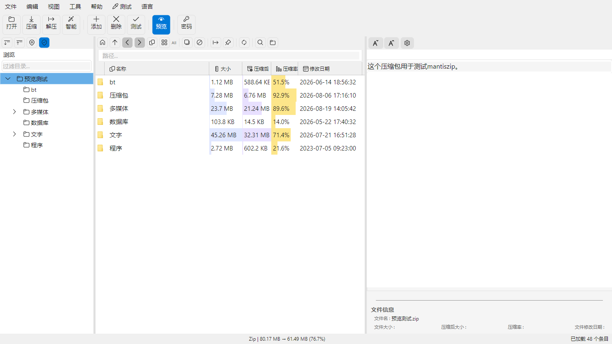
- 移除 WebView2 依赖 — HTML/Markdown 改为原生控件树渲染（ReverseMarkdown→Markdig），PDF 改为 PdfPig+SkiaSharp 逐页位图，SVG 改为 Svg.Skia 栅格化；安装不再需要 WebView2 Runtime
- Removed WebView2 dependency — HTML/Markdown rendered as native control trees (ReverseMarkdown→Markdig), PDF rendered page-by-page via PdfPig+SkiaSharp, SVG rasterized via Svg.Skia; no WebView2 Runtime required
- 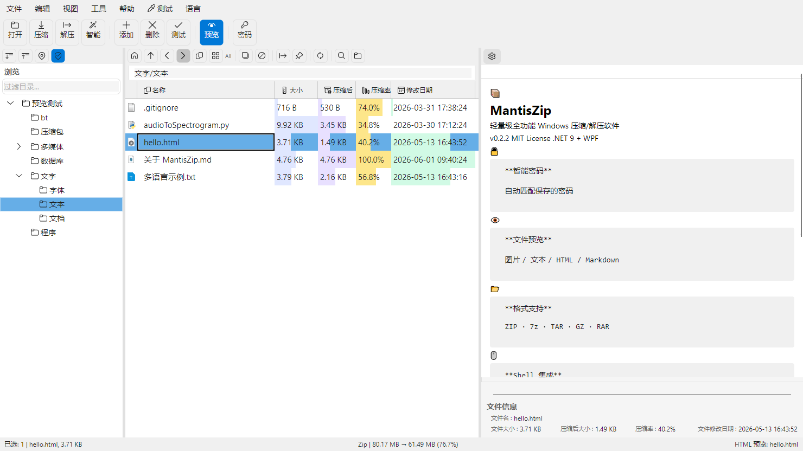
- 自实现 GIF 解码器与字体预览引擎 — GIF 动画不再依赖 WpfAnimatedGif；字体预览改用 HarfBuzzSharp+SkiaSharp 位图渲染（含自动连字检测）
- Self-implemented GIF decoder and font preview engine — GIF animation no longer relies on WpfAnimatedGif; font preview uses HarfBuzzSharp+SkiaSharp bitmap rendering (with automatic ligature detection)
- 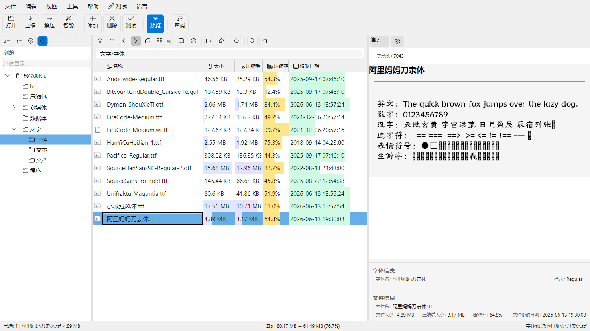
- 新增 Animated WebP 动画预览 — 与 GIF 动画统一处理，静态 WebP 保持图片预览
- Added Animated WebP preview — unified with GIF animation handling; static WebP stays as image preview
- GIF/动画透明棋盘格切换 — 🏁 按钮切换透明背景显示
- GIF/animated transparency checkerboard toggle — 🏁 button switches transparent background display
- 新增 Office 文档内容预览 — DOCX 大纲导航+全文+真 Grid 表格、XLSX DataGrid 表格、PPTX 原始坐标定位预览（WPF 版仅显示元数据）
- Added Office document content preview — DOCX outline navigation + full text + real Grid tables, XLSX DataGrid tables, PPTX original-coordinate positioned preview (WPF version only showed metadata)
- 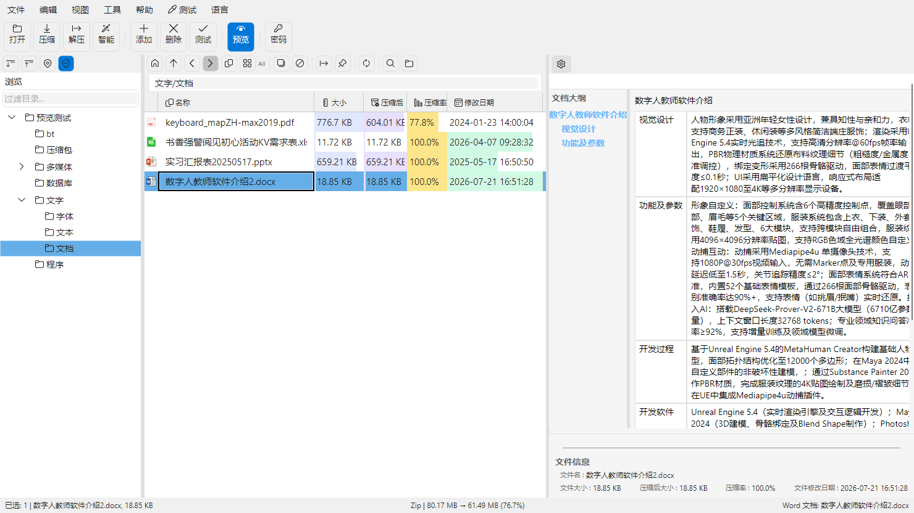
- 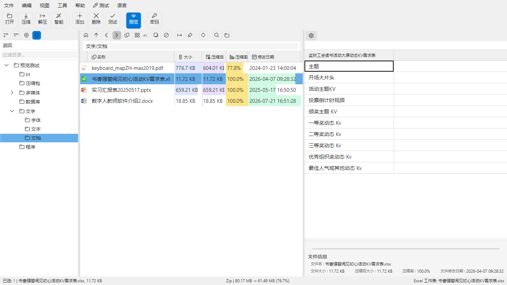
- 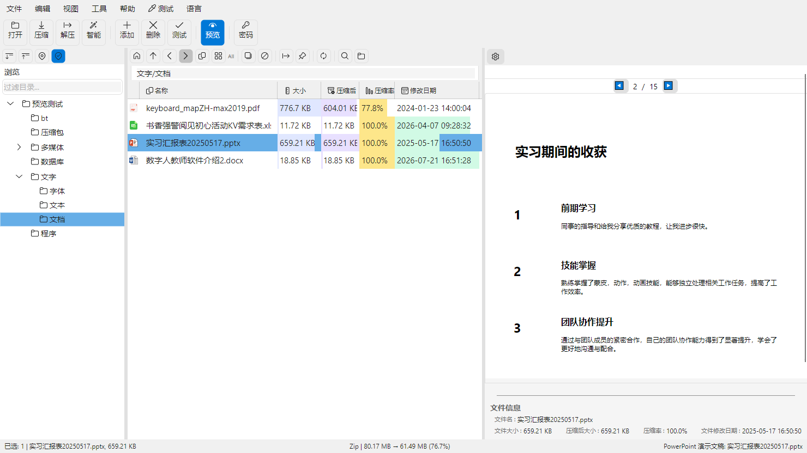
- 打开压缩包自动展示注释 — 支持 ZIP 注释（GBK/UTF-8 编码兼容）与 RAR5 注释读取
- Archive comments shown automatically on open — supports ZIP comments (GBK/UTF-8 compatible) and RAR5 comment reading
- 新增紧凑度模式 — Compact/Normal/Loose 三档间距与控件高度，运行时切换无需重启
- Added compactness mode — Compact/Normal/Loose spacing and control heights, switchable at runtime without restart
- 新增全局界面字体设置
- Added global UI font setting
- 主题三态化 — 跟随系统 / 亮色 / 暗色（WPF 版仅亮/暗）
- Theme tri-state — System / Light / Dark (WPF version only had Light/Dark)
- 
- 新增结果预览面板 — 压缩/解压设置窗口实时文件树预览，冲突高亮、过滤灰显、精简模式、异步加载
- Added result preview panel — real-time file tree preview in compress/extract dialogs with conflict highlighting, filtered ghosting, compact mode, async loading
- 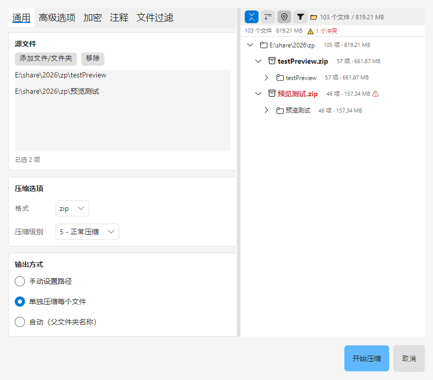
- 元数据信息面板可配置 — 字段排布自定义（信息栏/内容区顶部/隐藏+行+顺序），独立配置文件持久化
- Configurable metadata info panel — custom field layout (info panel / content top / hidden + row + order), persisted in a separate config file
- 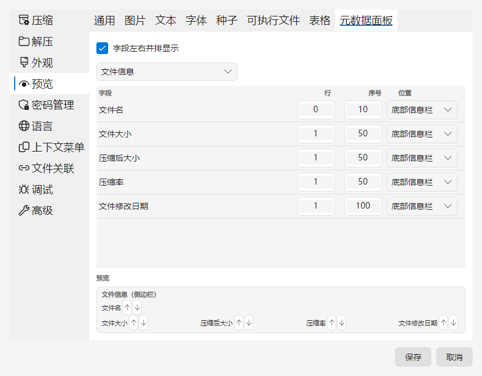
- 自定义文件选择器 — 多选累积、目录树、收藏/历史/窗口速选、盘符下拉、文件类型筛选，替代系统对话框
- Custom file picker — multi-select accumulation, directory tree, favorites/history/windows quick-pick, drive dropdown, file type filter; replaces system dialogs
- 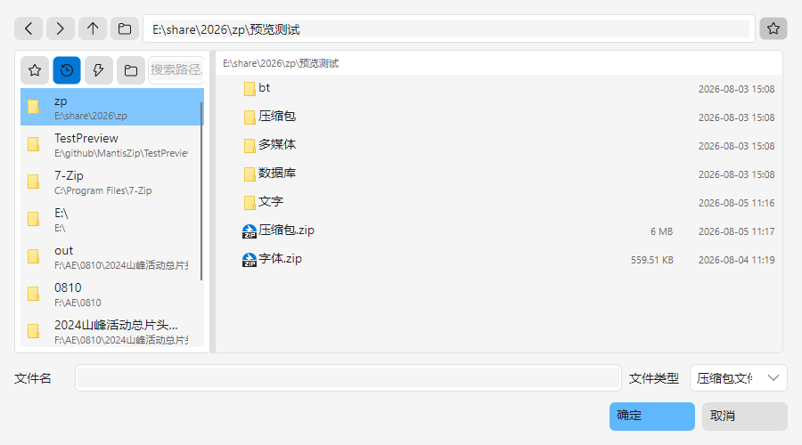
- 可排序默认路径优先级 — context/explorer/recent/custom 四来源可排序，支持手动路径与桌面兜底
- Sortable default path priority — context/explorer/recent/custom sources sortable, with manual path and desktop fallback
- 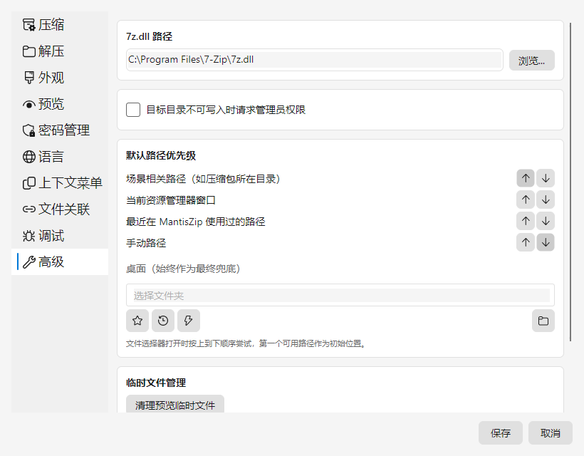
- 拖拽直接解压新模型 — 拖出压缩包到 Explorer 目标目录实时解压，Win32 覆层三色状态指示 + 动态光标 + Esc 取消
- New drag-to-extract model — drag archive onto an Explorer target directory to extract in real time; Win32 overlay three-color state indicator + dynamic cursor + Esc cancel
- 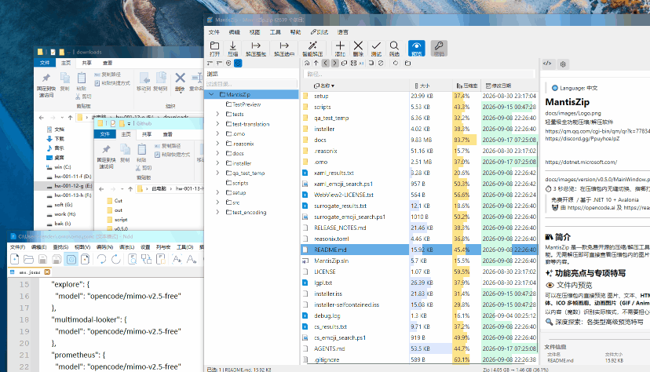
- 新增目录树自动展开开关 — 自动展开到当前浏览位置
- Added auto-expand directory tree toggle — automatically expands to the currently browsed location
- 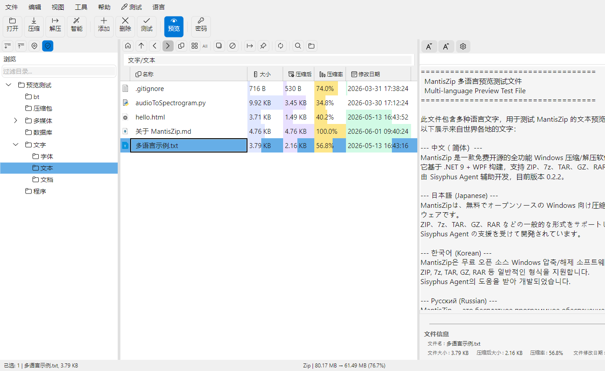
- 拖拽添加到压缩包 — 从资源管理器拖文件/文件夹到 MantisZip 窗口即可添加到当前目录，拖入压缩包一键切换打开，窗口内绿色覆层即时提示可添加状态
- Added drag-to-add — drag files/folders from Explorer onto the MantisZip window to add them to the current folder; dropping an archive switches to it; a green in-window overlay instantly shows addable state
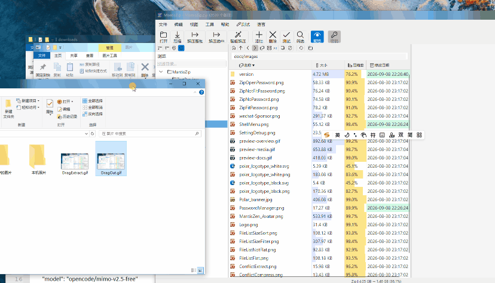
- 文件列表列排序增强 — 点击列头三态循环（升序→降序→恢复原始顺序）+ 列头箭头指示 + 排序状态跨会话持久化
- Enhanced file list column sorting — clicking a column header cycles ascending → descending → original order, with header arrow indicator and cross-session sort persistence
- 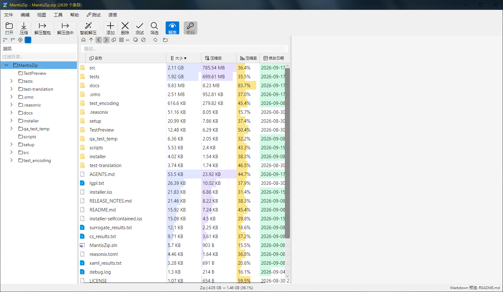
- 目录行聚合显示 — 目录行大小/日期/压缩后大小由子树聚合得出（大小=子树文件之和、日期=最新文件时间），一眼看清目录内容规模
- Directory row aggregation — directory rows show aggregated size/date/compressed size from their subtree (size = sum of contained files, date = newest file), so folder sizes are visible at a glance
- 保存布局 — 拖动列宽/预览面板调整后可一键保存，「查看」菜单保留布局项，下次启动自动恢复
- Save layout — after resizing columns or the preview panel, save once and it restores automatically on next launch (View menu → "Save Layout")

## v0.4.5

### 文件说明 / File Description

MantisZip-0.4.5-Setup-WebSetup.exe 是需要联网才能安装的。MantisZip-0.4.5-Setup-Offline.exe 是离线安装包。MantisZip-0.4.5-Portable.zip 是便携版，解压即用。

MantisZip-0.4.5-Setup-WebSetup.exe requires internet during installation. MantisZip-0.4.5-Setup-Offline.exe is a fully offline installer. MantisZip-0.4.5-Portable.zip is the portable version, extract and run.

### 更新内容 / Changelog

- 完成 [压缩选项增强](.omo/plans/已完成/compression-options-enhancement.md) 计划 — 7z 字典大小、固实块、Word Size、匹配器可配置；ZIP 压缩方法（Deflate/Deflate64/BZip2/LZMA/PPMd/Store）可配置；ZIP/7z 加密方式可配置，7z 支持加密文件名开关
- Completed [Compression Options Enhancement](.omo/plans/已完成/compression-options-enhancement.md) plan — configurable 7z dictionary size, solid block, word size, match finder; configurable ZIP compression method (Deflate/Deflate64/BZip2/LZMA/PPMd/Store); configurable ZIP/7z encryption method, 7z encrypt headers toggle
- 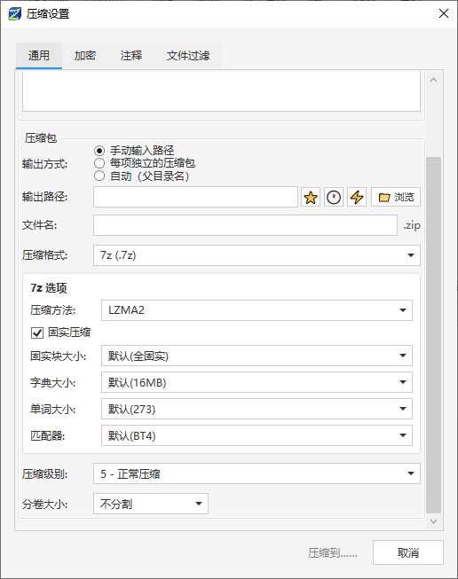
- 完成 [文件过滤功能](.omo/plans/已完成/file-filter-feature.md) 计划 — 支持按扩展名、文件名、尺寸、日期过滤，可保存为命名预设
- Completed [File Filter](.omo/plans/已完成/file-filter-feature.md) plan — filter by extension, filename, size, or date range; supports named presets persisted in settings
- 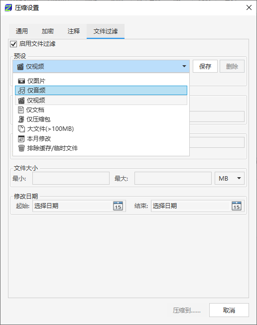
- 新增便携模式，CI 自动生成 Portable 压缩包
- Added portable mode; CI automatically generates Portable zip
- 解压路径统一 — `ExtractSelectedAsync` 改为调用引擎 `ExtractEntriesAsync`
- Unified extract path — `ExtractSelectedAsync` now delegates to engine `ExtractEntriesAsync`
- 视图菜单新增"隐藏预览信息"开关，预览信息面板可独立显隐控制
- Added "Hide Preview Info" toggle in View menu for independent control of preview info panel visibility
- 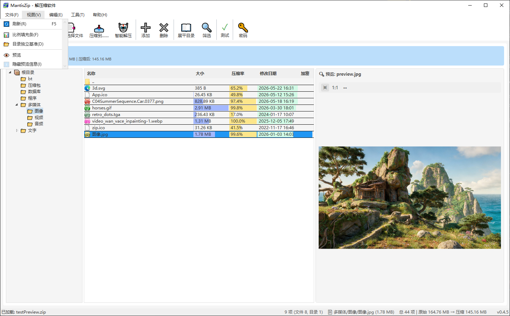
- 可配置双击行为 — 设置窗口新增"双击压缩包"选项（打开/原地解压/智能原地解压/打开解压窗口），`--open` CLI 按配置路由 (#16)
- Configurable double-click behavior — new "double-click archive" option in Settings (open/extract-here/smart-extract/extract-dialog); `--open` CLI routes accordingly
- 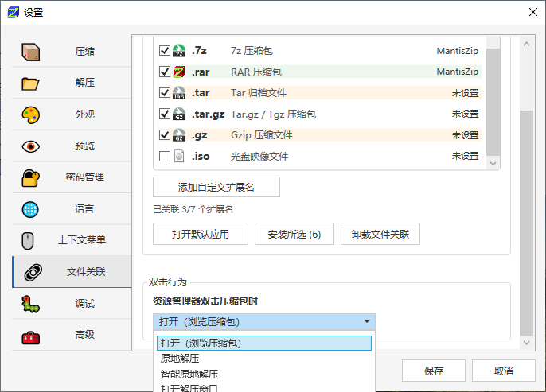
- 解压后自动删除原压缩包 — 新增"解压完成后将原压缩包移到回收站"选项，(#16)
- Auto-delete archive after extraction — new option to move original archive to Recycle Bin
- 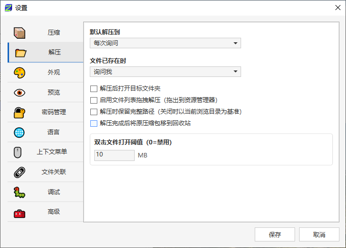
- 文件冲突窗口增加“暂停”和“取消”按钮。(#25)
- Add ‘Pause’ and ‘Cancel’ buttons to the file conflict window.
- 
- 修复安装后会导致别的软件安装完启动时错误本软件的问题。
- Fixed issue where installing other software could incorrectly route their startup to MantisZip.

## v0.4.4

### 文件说明 / File Description

MantisZip-0.4.4-Setup-WebSetup.exe 是需要联网才能安装的。MantisZip-0.4.4-Setup-Offline.exe 是离线安装包。

MantisZip-0.4.4-Setup-WebSetup.exe requires internet during installation. MantisZip-0.4.4-Setup-Offline.exe is a fully offline installer.

### 更新内容 / Changelog

- 完成 [魔数检测预览系统](.omo/plans/已完成/preview-magic-detection.md) 计划 — 通过文件内容（魔数）识别真实格式预览，不再依赖扩展名
- Completed [Magic Detection Preview System](.omo/plans/已完成/preview-magic-detection.md) plan — identifies file formats by content (magic bytes) for preview, no longer relies on file extensions
- 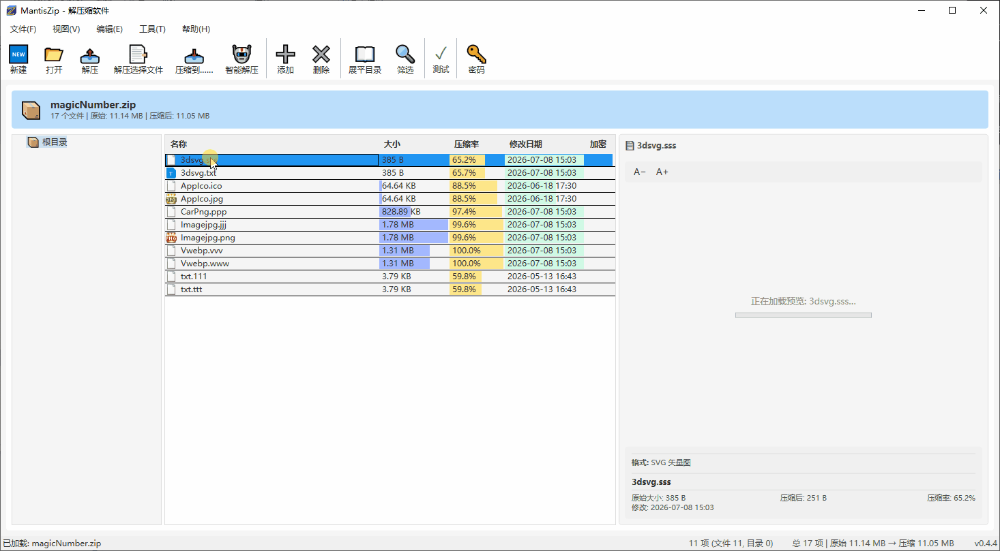
- 魔数检测结果与扩展名不一致时，可在工具栏切换"按扩展名/按魔数"预览
- When magic detection conflicts with the file extension, toggle between "by extension / by magic number" preview in the toolbar
- 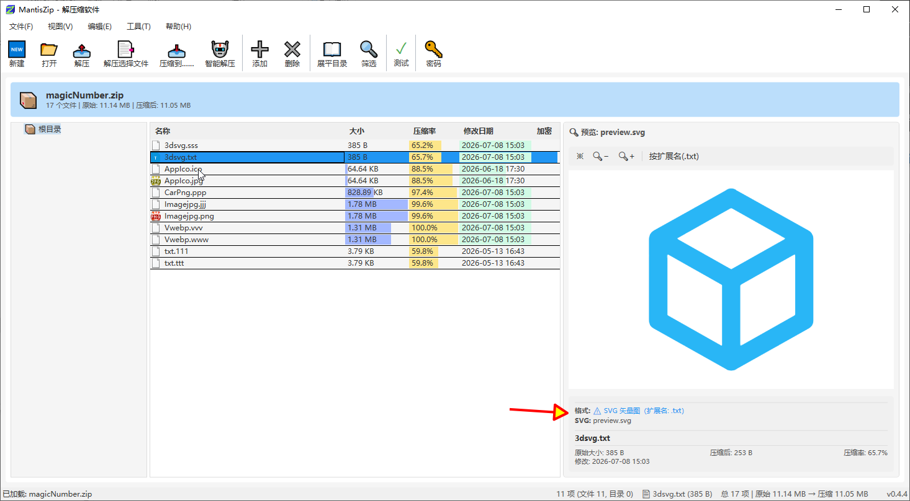
- 完成压缩包路径处理一站式重构 `ArchivePath`，统一了散落在各处的路径处理代码，并修复了加密压缩解压的多处 bug
- Completed one-stop archive path refactoring (`ArchivePath`), unified scattered path handling code, and fixed multiple encryption-related compression/extraction bugs
- 密码流程统一重构 — 统一密码入口 `ResolvePasswordAsync`，调用方大幅简化
- Unified password flow refactoring — centralized password entry via `ResolvePasswordAsync`, significantly simplified callers
- 双击文件用系统默认程序打开（可在设置中调整阈值）
- Double-click files to open with system default program (threshold configurable in settings)
- 安装包增强，文件名重命名：`WebSetup`（联网）/ `Offline`（离线），联网安装包可自动下载所需依赖
- Installer improvements: renamed to `WebSetup` (online) / `Offline` (offline); online installer automatically downloads required dependencies
- 离线安装包新增自包含模式，无需安装 .NET Runtime
- Offline installer now includes self-contained mode, no .NET Runtime installation required

## v0.4.3

### 文件说明 / File Description

MantisZip-0.4.3-Setup-NoDotNet.exe 是需要安装 dotnet runtime 才能运行的。MantisZip-0.4.3-Setup.exe 是自包含 dotnet runtime 的。

MantisZip-0.4.3-Setup-NoDotNet.exe requires the .NET runtime to be installed. MantisZip-0.4.3-Setup.exe is self-contained with the .NET runtime.

**如果你不明白上面那句话是什么意思，请下载 MantisZip-0.4.3-Setup.exe。**

**If you don't understand what the above means, please download MantisZip-0.4.3-Setup.exe.**

### 更新内容 / Changelog

- 完成 [快速路径选择](.omo/plans/已归档/quickpath-unified.md) 计划。
- Completed [Quick Path Selection](.omo/plans/已归档/quickpath-unified.md) plan.
- 快速路径选择，在"浏览"按钮旁边加上三个用于切换路径的按钮。（灵感来自软件 Listary）
- Quick Path Selection: added three buttons next to the "Browse" button for switching paths. (Inspired by Listary)
- 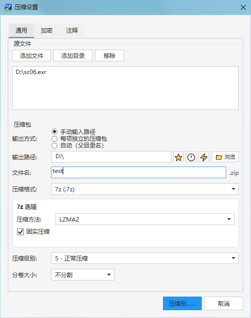
- 可以把常用路径加入书签，在"书签"按钮弹出菜单里面选择并切换。
- Frequently used paths can be bookmarked and selected via the "Bookmark" button popup menu for quick switching.
- 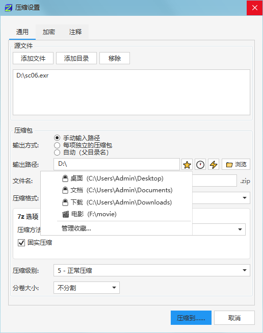
- 可以在书签管理器里面管理书签。
- Bookmarks can be managed in the Bookmark Manager.
- 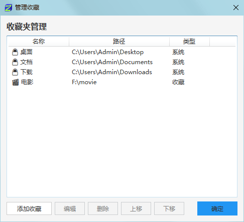
- "历史"按钮，弹出菜单里面会显示最近的用到的目录并切换。
- The "History" button shows recently used directories in a popup menu for quick switching.
- 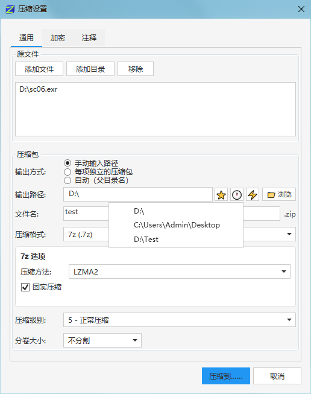
- "切换"按钮，弹出菜单里面会显示此时打开的资源管理器目录并切换。
- The "Switch" button shows currently open Explorer directories in a popup menu for quick switching.
- 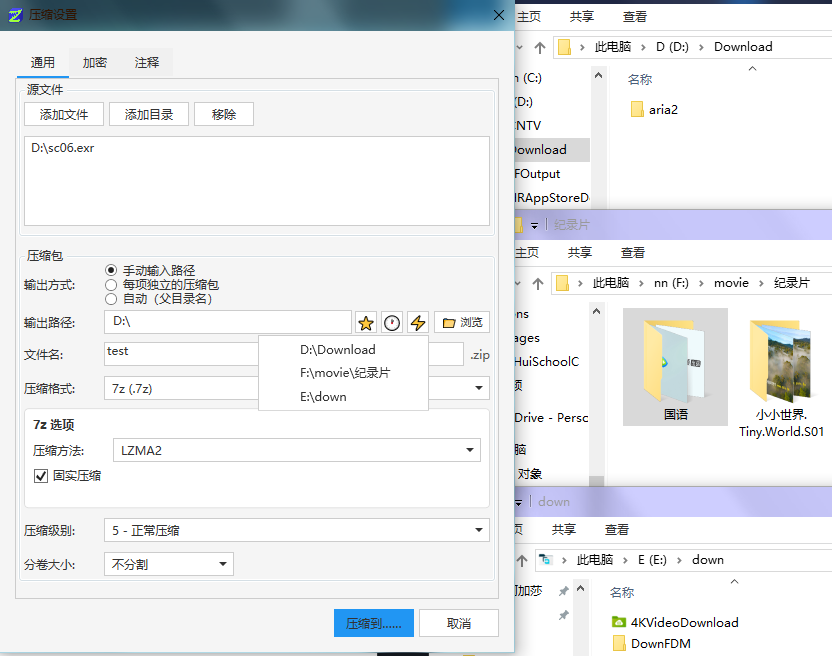

## v0.4.2

### 文件说明 / File Description

MantisZip-0.4.2-Setup-NoDotNet.exe 是需要安装 dotnet runtime 才能运行的。MantisZip-0.4.2-Setup.exe 是自包含 dotnet runtime 的。

MantisZip-0.4.2-Setup-NoDotNet.exe requires the .NET runtime to be installed. MantisZip-0.4.2-Setup.exe is self-contained with the .NET runtime.

**如果你不明白上面那句话是什么意思，请下载 MantisZip-0.4.2-Setup.exe。**

**If you don't understand what the above means, please download MantisZip-0.4.2-Setup.exe.**

### 更新内容 / Changelog

- 修复上下文动态菜单有时会闪烁的问题。
- Fixed issue where dynamic context menus sometimes flickered.
- 修复安装时选择语言和外观无效的问题（感谢 Peiming_The_Blank）。
- Fixed issue where language and appearance selection during installation was ineffective (thanks to Peiming_The_Blank).
- 完成计划 [zip 复制模式](.omo/plans/已完成/zipengine-sharpcompress-migration.md)，添加删除文件不再是"解压缩→重新压缩"，而改成了"复制模式"。速度极大提升。
- Completed plan: [ZIP copy mode](.omo/plans/已完成/zipengine-sharpcompress-migration.md). Adding/deleting files now uses "copy mode" instead of "decompress → recompress". Significantly faster.
- 完成计划 [权限提升](.omo/plans/已完成/uac-elevation-permission.md)，当压缩解压到无权限的目录时，会有正确的处理（感谢 xieyilin.main）。
- Completed plan: [UAC elevation](.omo/plans/已完成/uac-elevation-permission.md). Proper handling when compressing/extracting to directories without permission (thanks to xieyilin.main).
- 
- 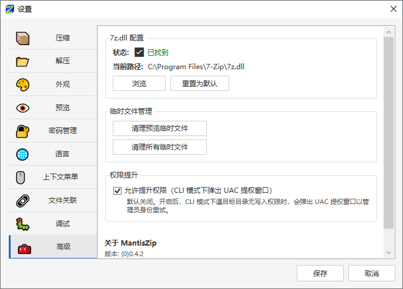
- 

## v0.4.1

### 文件说明 / File Description

MantisZip-0.4.1-Setup-NoDotNet.exe 是需要安装 dotnet runtime 才能运行的。MantisZip-0.4.1-Setup.exe 是自包含 dotnet runtime 的。

MantisZip-0.4.1-Setup-NoDotNet.exe requires the .NET runtime to be installed. MantisZip-0.4.1-Setup.exe is self-contained with the .NET runtime.

**如果你不明白上面那句话是什么意思，请下载 MantisZip-0.4.0-Setup.exe。**

**If you don't understand what the above means, please download MantisZip-0.4.0-Setup.exe.**

### 更新内容 / Changelog

- 修复上下文动态菜单有时不能起效的问题，并增加了不使用动态菜单的选项
- Fixed issue where dynamic context menus sometimes didn't work, and added an option to disable dynamic menus
- 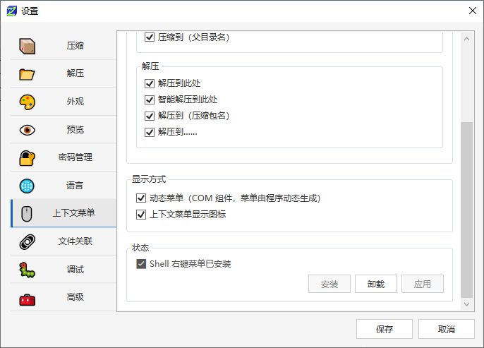
- 文件列表增加回到父目录的行
- Added a "go to parent directory" row in the file list
- 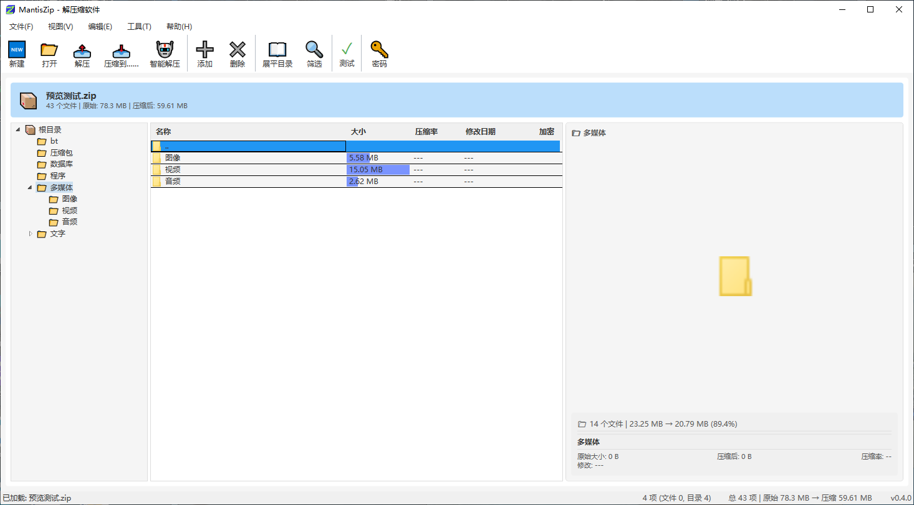
- 文件列表目录回车改成进入该目录
- Changed Enter key on directories in the file list to navigate into that directory

## v0.4.0

### 文件说明 / File Description

MantisZip-0.4.0-Setup.exe 是需要安装 dotnet runtime 才能运行的。MantisZip-0.4.0-Setup-SelfContained.exe 是自包含 dotnet runtime 的。

MantisZip-0.4.0-Setup.exe requires the .NET runtime to be installed. MantisZip-0.4.0-Setup-SelfContained.exe is self-contained with the .NET runtime.

**如果你不明白上面那句话是什么意思，请下载 MantisZip-0.4.0-Setup-SelfContained.exe。**
**If you don't understand what the above means, please download MantisZip-0.4.0-Setup-SelfContained.exe.**

### 软件第一个版本 / First Release

- 软件功能基本完整，测试基本完成。
- Core features are complete and testing is largely finalized.
- 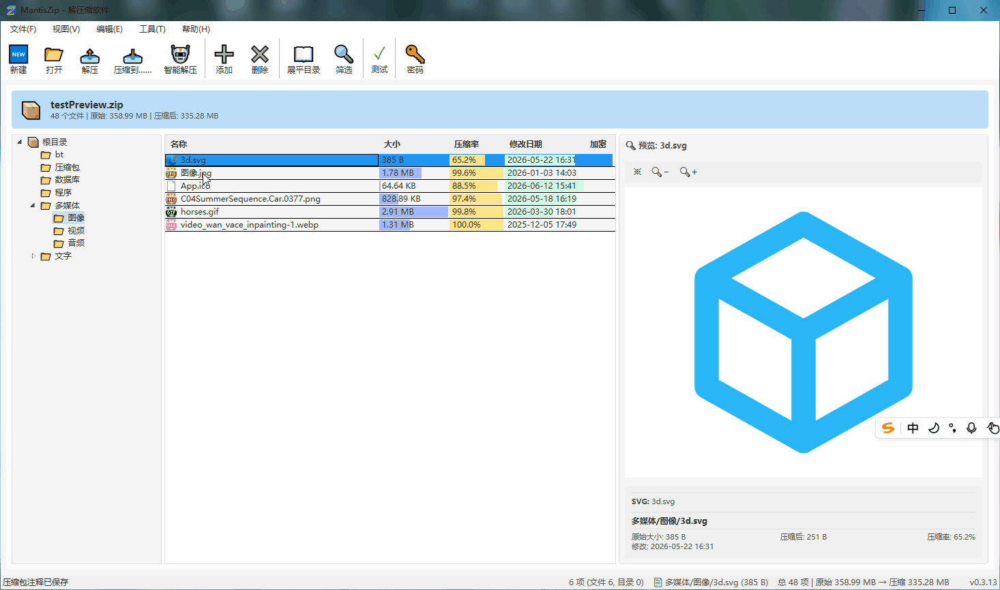
- 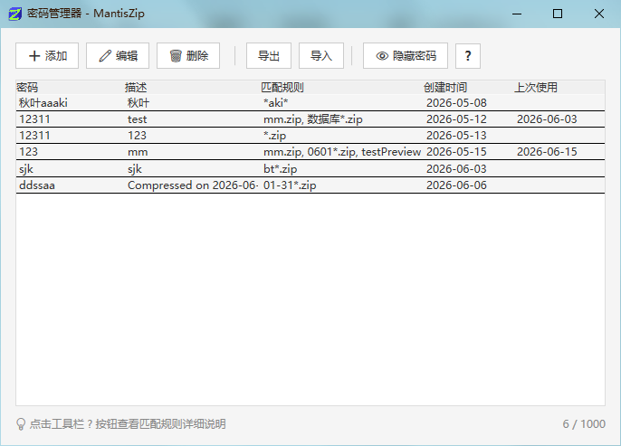

## v0.0.0

# Release Notes / 发布说明

> **每次发布前在此文件顶部写入本次更新的内容，CI 会自动将其作为 GitHub Release 的说明文字。**
> **Write the update notes at the top of this file before each release. CI will automatically use them as the GitHub Release description.**
>
> 保留之前版本的记录在下面供参考，上面最新内容会被 CI 读取。
> Keep records of previous versions below for reference. The latest content at the top will be read by CI.
