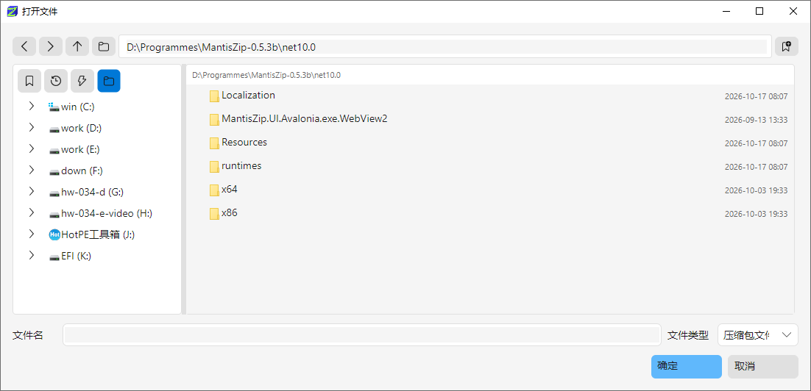
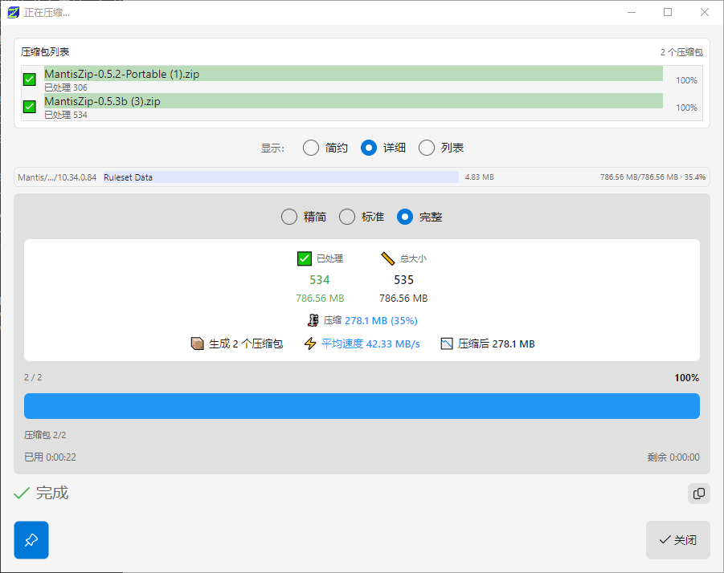
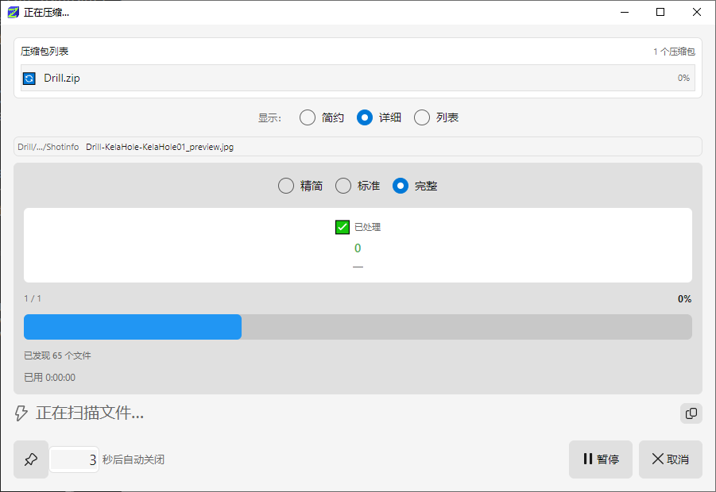
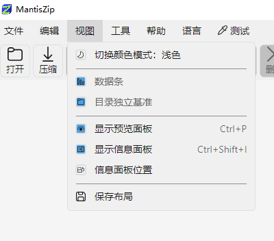
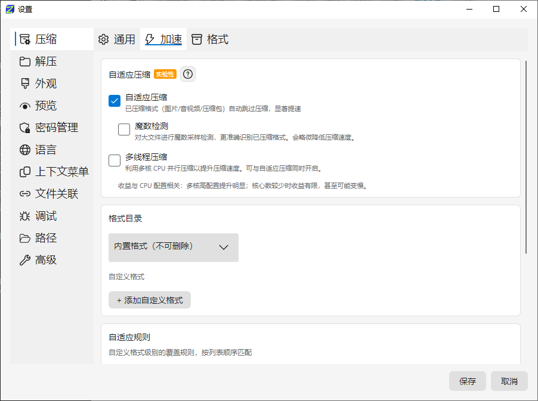
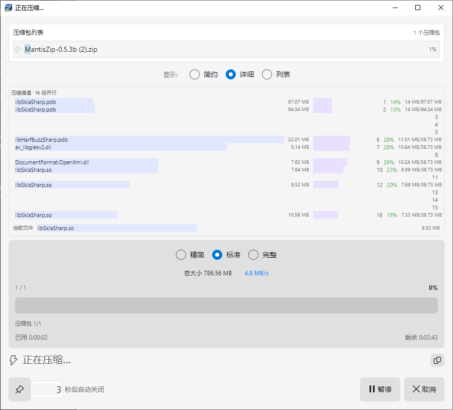
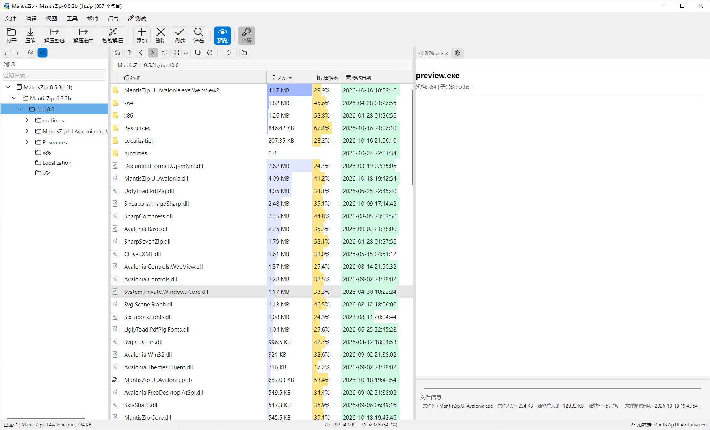

## v0.5.4

### 文件说明 / File Description

MantisZip-0.5.4-Setup-WebSetup.exe 是需要联网才能安装的。MantisZip-0.5.4-Setup-Offline.exe 是离线安装包。MantisZip-0.5.4-Portable.zip 是便携版，解压即用。MantisZip-0.5.4-Portable-Web.zip 是无依赖便携版，需要电脑安装有 .NET 10 运行时才能正常使用。

MantisZip-0.5.4-Setup-WebSetup.exe requires internet during installation. MantisZip-0.5.4-Setup-Offline.exe is a fully offline installer. MantisZip-0.5.4-Portable.zip is the portable version, extract and run. MantisZip-0.5.4-Portable-Web.zip is a dependency-free portable version that requires the .NET 10 runtime to be installed on your computer.

### 更新内容 / Changelog

**界面 / UI**

- **图标显示尺寸与前景色统一** — 图标尺寸此前 14/15/16px 混用，现在统一 16px（21 个界面文件共 109 处）；工具栏与小按钮里缺少前景色的图标现在跟随主题文字色（深色主题下不再出现看不见的黑图标），选中态仍为白色
- **Icon sizes and foregrounds unified** — icon sizes used to mix 14/15/16 px and are now uniformly 16 px (109 sites across 21 files); icons in toolbars and small buttons that had no foreground color now follow the theme's text color (no more invisible black icons on dark themes), while the checked state stays white
- **切换按钮选中态改用主题强调色** — 结果树视图的「紧凑模式」「显示筛选条件」、路径栏的四个路径标签、进度窗口底部的三个开关，选中时背景此前不变色（是浅灰底 + 白图标，浅色主题下几乎看不清）；现在统一使用主题强调色背景 + 白色图标，未选中态观感不变，浅色/深色主题都清晰
- **Toggle buttons now show the accent color when checked** — the result tree's compact-mode and filter toggles, the four path tabs in the path bar, and the three toggles at the bottom of the progress window used to keep their neutral background when checked (light grey with a white icon, barely legible on light themes); they now use the theme's accent background with a white icon, with the unchecked look unchanged and both themes rendering clearly
- **预览不再先写临时文件** — 预览文本、代码、日志、CSV、Markdown 时直接从内存取数，图片与 PDF 同样在内存里解码，不再每次都把整个条目解到 `%TEMP%\MantisZip\Preview\` 再读回来；顺带修掉「同时预览两个文件会互相删掉临时文件」的老问题（以前每次预览前都会清空整个临时目录），看敏感文件时也不再往 TEMP 留明文。必须吃真实文件路径的格式（HTML 预览、打开方式、字体、GIF/APNG/SVG/ICO/TGA）行为不变
- **Preview no longer writes a temporary file first** — text, code, log, CSV and Markdown previews now read straight from memory, and images and PDFs decode in memory too, instead of extracting the whole entry to `%TEMP%\MantisZip\Preview\` and reading it back every time. This also fixes the old bug where previewing two files at once deleted each other's temp file (the whole temp folder used to be wiped before every preview), and sensitive files no longer leave plaintext copies in TEMP. Formats that genuinely need a real path (HTML preview, open-with, fonts, GIF/APNG/SVG/ICO/TGA) behave exactly as before
- **大文本不再一律被拒** — 超过 1MB 的文本、CSV、Markdown 以前直接提示「文件过大」不给看；现在改为显示前 1MB，并在状态栏标注「仅显示前 0.9 MB（全文 20.0 MB）」，超过 256MB 才整体拒绝（再大的文本即使只取开头也要先把整条解出来，无上限会把磁盘写满）。HTML、图片、Office 文档仍按原有大小限制处理
- **Large text files are no longer rejected outright** — text, CSV and Markdown files over 1MB used to show "file too large" and nothing else; they now show the first 1MB with a status hint like "showing the first 0.9 MB of 20.0 MB", and are only refused above 256MB (even reading just the beginning of an enormous entry may mean extracting it whole, so an unbounded limit could fill the disk). HTML, images and Office documents keep their original size limits
- **自动更新检测** — 启动时会在后台静默检查有没有新版本（延迟 2 秒，不拖慢启动，失败绝不打扰；频率在「设置 → 更新」里可选「关闭 / 每次启动 / 每天 / 每周」，默认每天）；发现新版本才弹提示，可选「下载」（交给系统浏览器打开发布页，应用内不下载安装）、「稍后提醒」（按所设频率再问）或「不再提示此版本」（该版本永久静默，出了更新的版本仍会提示）
- **Automatic update checks** — on startup the app quietly checks for a newer release in the background (2-second delay, never slows startup, failures stay silent; the frequency is configurable under Settings → Updates as Off / Every startup / Daily / Weekly, defaulting to daily); only when a new version exists does it prompt, offering "Download" (opens the release page in your browser — nothing is downloaded or installed by the app), "Remind me later" (asks again at the configured frequency) or "Skip this version" (that version stays silent; a later release will prompt again)
- **「关于」窗口新增「更新」页签** — 可以看到当前版本与上次检查时间，手动点「检查更新」；发现新版本时在同一页显示版本号、发布日期、更新说明（GitHub 发布说明原文，按 Markdown 渲染）和「打开发布页」按钮
- **New "Updates" tab in the About window** — shows the current version and the last check time, with a manual "Check for updates" button; when a newer release exists, its version, publish date, release notes (the GitHub release body, rendered as Markdown) and an "Open release page" button appear right there
- **文件关联与「打开压缩包」筛选分两列勾选** — 「设置 → 文件类型关联」里每个格式前面现在是两个勾：左边是**文件关联**（资源管理器里双击/右键交给本应用），右边是**「打开压缩包」筛选**（决定打开对话框里默认能看到哪些格式），两列互不影响；清单也从写死的 8 项补全到全部可识别格式（`.jar` `.war` `.ear` `.apk` 与分卷的 `.001` 都能看到），新增的这几项**默认不勾关联**，不会悄悄抢走 JDK、APK 安装器或分卷工具已有的默认程序，想接管时自己勾。表头有图例，两列各有一键全选 / 全不选；自定义扩展名关联后也终于有了自己的图标（`custom.ico`），不再是空白
- **File associations and the "open archive" filter are now two separate columns** — every format in Settings → File associations has two checkboxes: the left one is the **file association** (double-click/right-click in Explorer hands the file to this app) and the right one is the **"open archive" filter** (which formats the open dialog shows by default), and the two are independent. The list also grows from a hard-coded 8 entries to every recognizable format (`.jar`, `.war`, `.ear`, `.apk` and the `.001` volume are all listed); these new entries are **not associated by default**, so they do not silently steal the default program from the JDK, APK installers or volume tools — tick them when you actually want to take over. A legend sits above the table and each column has select-all / clear-all, and custom extensions finally get their own icon (`custom.ico`) instead of a blank one

**修复 / Fixes**

- **打开中的压缩包被删掉 / 被替换后不再「假装还打开着」** — 解压时勾了「解压完成后删除压缩包」，包进了回收站，主窗口却仍显示这个包已打开，之后解压、添加文件、删除条目、刷新全都落到一个不存在的路径上（有的弹「找不到文件」，有的没反应）；压缩包被别的软件删除、被杀软隔离、被网盘同步搬走也是同样的状态。现在打开压缩包时会同时盯着它在磁盘上的状态（分卷包按整套卷看），一旦发现文件消失或被同名文件替换，就在内容区顶部显示只读提示（说明是哪个包，可「重新打开」或「关闭压缩包」），条目树仍可查看，这期间会读写该包的操作都会先被拦下并说明原因。自己删包那条路径更直接：解压收尾发现源包已不在，就自动关闭并提示「已移入回收站，已关闭」
- **An open archive that gets deleted or replaced no longer stays "open"** — if you ticked "delete the archive after extraction", the archive went to the Recycle Bin while the main window still showed it as open, and later extractions, file adds, entry deletes and refreshes all targeted a path that no longer existed (some said "file not found", others did nothing). The same stale state appeared when another program deleted the file, antivirus quarantined it, or a cloud client moved it away. Opening an archive now also watches its state on disk (for split volumes, the whole volume set); when the file disappears or is replaced by a different file at the same path, a read-only banner appears at the top of the content area (naming the archive, with "Reopen" and "Close archive"), the entry tree stays viewable, and operations that would read or write it are blocked with an explanation. The delete-after-extraction path is handled directly: if the source archive is gone when the run finishes, it is closed right away with "moved to the Recycle Bin and closed"
- **压缩包内删除目录现在真的会删掉** — 在压缩包里选中一个文件夹删除时，此前会静默「成功」：进度条走到 100%、状态显示「删除完成」，刷新后发现文件夹和里面的文件一个都没少。原因是列表里文件夹的路径不带结尾的 `/`、而压缩包内的条目带 `/`，逐条精确比较一条都对不上，快路径又不校验命中。现在删除按「该条目 或 该文件夹下的全部条目」匹配（结尾有没有 `/` 都行、不区分大小写，`a` 也不会误伤 `ab` 文件夹），一个都没命中时明确报「压缩包中不存在条目」而不再假装成功；只读格式（如 tar.gz）直接禁用删除入口，删除前还会先确认「其下 N 个文件（共 x MB）」；删除一完成文件列表就刷新，不用等进度窗口自动关闭的读秒走完
- **Deleting a folder inside an archive now really deletes it** — deleting a selected folder used to silently "succeed": the progress bar reached 100% and the status line said "Delete complete", yet after refreshing the folder and every file inside were still there. The listed folder path has no trailing `/` while archive entries do, so the entry-by-entry exact comparison matched nothing, and the fast path never validated a hit. Deletion now matches "this entry or anything under that folder" (trailing `/` optional, case-insensitive, and `a` no longer touches an `ab` folder), reports "Entry not found in archive" when nothing matches instead of pretending success, disables the delete entry points for read-only formats (e.g. tar.gz), and asks for confirmation showing "the N file(s) inside it (x MB)" first; the file list now refreshes the moment the deletion finishes instead of waiting for the progress window's auto-close countdown
- **7z 包删除不存在的条目不再白跑一遍** — 在 7z 压缩包里删除一个不存在的条目时，此前会把整个包解压到临时目录再原样重新打包（大包上白等几十秒到几分钟，还有条目属性与时间戳丢失的风险）；现在在动手之前就报错
- **Deleting a missing entry from a 7z archive no longer rewrites the whole archive** — it used to extract the entire archive to a temp folder and repack it unchanged (tens of seconds to minutes on large archives, with a risk of losing entry attributes and timestamps); it now fails fast before doing any work
- **`.jar`、`.war`、`.ear`、`.apk` 现在能当压缩包打开** — 这些文件此前一律报「不支持的文件格式」。原因是格式识别看到任何 `META-INF/` 条目就判定成 OpenDocument，而 jar 规范要求首条目正是 `META-INF/MANIFEST.MF`；随后「识别结果 → 引擎」的映射表又不认识这个类型，于是被当成不是压缩包。现在识别分两层（先只判容器、再判子类型），「当压缩包打开」只读容器，并收紧了 `META-INF/` 判据；顺带修掉了子类型扫描漏跳过压缩数据区、导致真实 ODF 文件一直识别不出来的老问题。注意：这几种格式**没有**注册文件关联，双击仍交给原有程序，拖进窗口或在「打开方式」里选 MantisZip 即可
- **`.jar`, `.war`, `.ear` and `.apk` can now be opened as archives** — these used to fail with "unsupported file format". Format detection treated any `META-INF/` entry as OpenDocument, while the jar spec requires the first entry to be `META-INF/MANIFEST.MF`; the follow-up mapping from detected type to engine did not know that type either, so the file was treated as "not an archive". Detection is now split into two layers (container first, subtype second), opening an archive reads only the container, and the `META-INF/` rule is stricter; a long-standing bug where subtype scanning skipped over compressed data (so real ODF files were never recognized) is fixed too. Note these formats are **not** registered as file associations — double-click still goes to your existing program; drag them in, or pick MantisZip under "Open with"
- **自解压 exe 现在能打开** — 自解压包是「PE 桩 + 尾部内嵌压缩包」，此前识别到可执行文件头就报不支持；即使硬塞给 zip 引擎也读不出来，它对这类文件会**静默返回 0 个条目**（看起来像个空包）。现在只有当你显式打开一个 `.exe` 时才探测：先看文件头，再在尾部 8 KB 里找 zip / 7z / RAR 签名，命中就交给 7z 引擎（它本来就支持按签名定位内嵌包）。`.exe` 不注册任何文件关联，资源管理器里双击可执行文件的语义完全不变
- **Self-extracting executables can now be opened** — an SFX is a "PE stub + embedded archive at the tail"; detection previously stopped at "executable" and reported it as unsupported, and even handing the file straight to the zip engine could not read it (it **silently returns 0 entries**, so it looked like an empty archive). Now an `.exe` is only probed when you explicitly open it: the head is checked, then the last 8 KB is searched for a zip / 7z / RAR signature, and a hit is routed to the 7z engine (which already locates embedded archives by signature). `.exe` gets no file association, so double-clicking an executable in Explorer behaves exactly as before

- **进度窗口暂停后「继续」按钮点不动** — 压缩过程中点暂停，再点「继续」没有任何反应，只能取消整次压缩；文件冲突选择、错误重试这几处也有同样的卡死风险。原因是这些对话框都在引擎线程上**同步等待**界面线程，而进度链的上游本身就跑在界面线程，两边互相等成了死锁。现在这几处统一改为把对话框投递到界面线程再异步等待，暂停/继续、冲突选择、错误重试都能正常收尾
- **Paused progress window could not be resumed** — pausing a compression run and then pressing "Resume" did nothing, so cancelling was the only way out; the file-conflict dialog and the error-retry prompt carried the same deadlock risk. Those dialogs were waiting **synchronously** on the UI thread from an engine thread while the progress chain itself was already running on the UI thread. They now post to the UI thread and await asynchronously, so pause/resume, conflict choices and retries all finish cleanly
- **压缩 / 解压设置窗口点「确认」后可能毫无反应** — 点「确认」后什么都没发生、也没有任何提示（例如还没添加要压缩的文件、两次输入的密码不一致、解压的过滤预览尚未算完）。原因是窗口把自己的状态放在公开属性上，由调用方在关窗后**逐项补读**，任何一项没搬到就静默失效。现在「确认」时一次性交出完整设置：参数不再有遗漏的可能，校验不通过会把原因直接显示在窗口里，而不是无声返回
- **Confirming the compress / extract dialog could silently do nothing** — pressing "Confirm" sometimes produced no window, no action and no message (for example with no source files added, with two mismatched password fields, or while the extract filter preview was still being computed). The dialog kept its state in public properties that the caller had to **copy item by item** after the window closed, so any missed item failed silently. Confirming now hands over the complete settings in one transaction, so nothing can be left behind, and a failed validation shows its reason right in the dialog instead of returning silently

- **便携版升级不再丢设置** — 此前便携版压缩包里自带一份默认设置，把它解压覆盖旧目录升级时会把你的设置冲成默认值（安装版一直不受影响）；此外设置文件一旦读不出来，会被静默换成默认值并当场覆盖原文件，事后无从恢复。现在便携包不再预置设置文件、首次运行自动生成；设置文件读坏时先改名为 `settings.json.bad-<时间>` 留证，再尝试从 `settings.json.bak` 恢复，保存时也会保留上一版备份，全过程记入 `lifecycle.log`
- **Portable upgrades keep your settings** — the portable zip used to ship a default settings file, so extracting it over an existing folder wiped your settings (the installer build was never affected); worse, an unreadable settings file was silently replaced with defaults and the original overwritten, leaving no way back. The portable zip no longer pre-seeds settings (they are generated on first run); an unreadable settings file is first renamed to `settings.json.bad-<time>` for evidence, then `settings.json.bak` is tried, and saving now keeps the previous copy as a backup — all recorded in `lifecycle.log`
- **数字输入框不再被乱敲出红字** — 自动关闭延时、最近文件数、表格预览行列数、双击打开阈值这几个输入框此前能敲进任意字符，敲错的瞬间就在下方渲染一段红色转换异常文本；现在统一换成受控输入（整数型数字框只接受整数，普通输入框挂一个可复用行为：按键直接拒收非数字、粘贴进来的脏字符自动清掉、失焦按上下限纠正、清空则还原上一个合法值），非法内容根本进不去
- **Numeric fields no longer accept arbitrary text** — the auto-close delay, recent-file count, table preview rows/columns and double-click threshold fields used to accept any character and immediately rendered a red conversion-error line underneath; they now use controlled inputs (integer spinners accept integers only, plain fields use a reusable behaviour that rejects non-digits as you type, cleans pasted text, clamps to the allowed range on blur and restores the previous valid value when emptied), so invalid text cannot get in at all
- **「压缩完成后关闭对话框」这个无效开关已删除** — 它从 v0.2.0 起就只把值存进设置文件、没有任何代码读取，勾不勾结果完全一样；真正决定「完成后是否自动关窗」的一直是「设置 → 外观 → 进度窗口」的自动关闭延时，以及进度窗口右上角那个图钉
- **Removed the no-op "Close dialog after compress" switch** — since v0.2.0 it only stored a value that nothing ever read, so ticking it or not made no difference; what actually decides whether the window closes itself is the auto-close delay under Settings → Appearance → Progress window, plus the pin button in the progress window itself
- **新增「外观 → 进度窗口」页签，可设默认钉住** — 外观页拆成「外观」与「进度窗口」两个子页签，后者放自动关闭默认时长，以及新选项「进度窗口默认钉住」（默认关）。开启后每个进度窗口一打开就处于钉住状态，压缩/解压/删除/测试结束都不会自动关闭、等你手动关（出错时原本就会自动钉住，不受这个开关影响）；运行中手动解钉会立刻恢复倒计时，不用等窗口自己发现
- **New "Appearance → Progress window" tab with default pinning** — the Appearance page is split into two sub-tabs, the second holding the default auto-close delay and a new "pin progress windows by default" option (off). When enabled, every progress window starts pinned, so compress/extract/delete/test runs no longer close it automatically and it waits for you (failures already pin automatically regardless of this option); unpinning while it waits now resumes the countdown immediately instead of being ignored
- **设置窗口语言页的「翻译贡献者」不再是空的** — 此前每个语言选项下面只显示「翻译贡献者：」后面一片空白。原因是语言元数据用区分大小写的 JSON 反序列化读取，而文件里的键名是小写，解析「成功」但字段全空；现在改为大小写宽容读取，并且显示的是**当前所选**语言的译者（切换下拉立刻跟着变，不再只反映已生效的语言）。语言名也统一为「简体中文」，菜单与设置页一致
- **The translator line on the language page is no longer empty** — every language option used to show "Translator:" followed by nothing, because the language metadata was read with a case-sensitive JSON deserializer while the file uses lowercase keys, so parsing "succeeded" with every field blank; it now reads case-insensitively and shows the contributor of the **selected** language (updates the moment you change the dropdown, instead of reflecting only the language already in effect). The Chinese language name is consistently "简体中文" in both the menu and settings

- **压缩跑完后「新建压缩包」按钮不再可能变灰不动** — 偶尔会出现一次压缩结束后主工具栏的「新建压缩包」仍然点不动，只能关掉应用重开。原因是进度窗口在等用户手动关闭时，如果窗口恰好在「检查是否已经关掉」与「订阅关闭事件」之间被关掉，这个等待就永远不会返回，整条调用链卡住，按钮也就一直停留在禁用状态。现在改为先订阅、再复查，并加了定时兜底：窗口已经关掉也能立刻收尾。这条链路同时会写入 `lifecycle.log`，万一以后再卡，可以直接从日志看出卡在哪一步
- **The "New archive" button can no longer stay greyed out after a run** — after a compression the toolbar button occasionally stayed disabled, and restarting the app was the only way out. While the progress window waited for you to close it manually, it could miss the close event if the window was closed between its "is it still open?" check and its event subscription; that wait then never returned, the whole call chain stalled and the command stayed disabled. It now subscribes first, re-checks afterwards and has a periodic fallback, so an already-closed window finishes immediately. The chain is also written to `lifecycle.log`, so a future stall can be located from the log
- **分卷压缩包能用了** — 别人用分卷压出来的 `.zip.001` / `.7z.001` / `.rar.001` 现在能直接打开、列目录、解压（此前会被当成普通 ZIP 交给不支持多卷的读取库，报 `Failed to locate the Zip Header`）；点任意一卷都会自动从 `.001` 读起。勾了「解压后删除压缩包」时，整套分卷会一起删掉，不再只删第一卷；打开对话框的筛选里也能选到 `*.001`。另外 7z 分卷的末卷内容被损坏（长度不变）以前会被误判成「加密包」弹密码框，现在会正确提示损坏。最后，打开对话框的筛选除了内置格式与 `*.001`，还会带上你在「设置 → 文件类型关联」里自定义的扩展名（自动去空白、补点、与内置重复时只保留一条）。
- **Split archives now work** — `.zip.001` / `.7z.001` / `.rar.001` sets produced by other tools can be opened, listed and extracted (they used to be handed to a reader that cannot do multi-volume, failing with `Failed to locate the Zip Header`); picking any volume starts reading from `.001`. With "delete archive after extraction" the whole set is removed, not just the first volume, and the open dialog filter now offers `*.001`. A damaged last 7z volume (same length, changed bytes) used to be mistaken for an encrypted archive and prompted for a password; it is now reported as damaged. The open dialog filter also includes the custom extensions you added under Settings → File type associations (trimmed, dot-normalised, de-duplicated against the built-ins).

**安装包 / Installers**

- **两个安装包现在是同一个产品，换变体变成一次正常升级** — 此前 Setup-WebSetup 与 Setup-Offline 用了两个不同的安装身份却写进同一个安装目录，装另一个变体时不会先卸掉旧版：同一台机器会留下两条同名的「应用和功能」条目、两套卸载程序互相删除对方正在用的文件，卸载后外壳扩展与文件关联的注册表项还会残留（极端情况下双击图标直接弹「You must install or update .NET」）。现在两者统一为一个产品身份：安装前会自动静默卸载旧版，只有卸载时才做的清理（外壳扩展、文件关联）不会再被跳过；已经装过旧 Offline 版的机器首次安装新版时会自动收起那条旧条目，不需要手动卸载。注意：两个变体现在**不能再同时安装**（此前只是假共存）
- **Both installers are now one product, so switching variants is a normal upgrade** — the WebSetup and Offline packages used two different installer identities while writing into the same install folder, so installing the other variant never removed the old one: two identically named entries under "Apps & features", two uninstallers deleting files the other one was using, and leftover shell-extension/file-association registry keys after uninstalling (in the worst case double-clicking the icon showed "You must install or update .NET"). Both variants now share one product identity: the previous version is silently uninstalled first, uninstall-only cleanup (shell extension, file associations) can no longer be skipped, and machines that already installed the old Offline build have that entry folded away automatically on the first install of the new one, with no manual uninstall needed. Note: the two variants can no longer be installed side by side (previously they only pretended to coexist)
- **卸载时可以选择同时删除个人设置** — 卸载时如果存在个人设置目录会询问一次，默认「否」；无论是否删除，注册表里的首次运行标记都会被清理，下次安装是干净状态
- **Uninstall can optionally remove your personal settings** — if a settings folder exists, uninstall asks once (default "No"); the first-run markers in the registry are cleared either way, so the next install starts clean
- **WebSetup 里跳过运行时下载要再确认一次** — 选择不下载 .NET 10 运行时会第二次确认（默认按钮是「否」），并提示离线安装包已自带运行时，避免装完双击打不开
- **Skipping the runtime download in WebSetup now asks again** — choosing not to download the .NET 10 runtime triggers a second confirmation (defaulting to "No") that points out the offline package bundles the runtime, so an install cannot silently end up unable to start

## v0.5.3

### 文件说明 / File Description

MantisZip-0.5.3-Setup-WebSetup.exe 是需要联网才能安装的。MantisZip-0.5.3-Setup-Offline.exe 是离线安装包。MantisZip-0.5.3-Portable.zip 是便携版，解压即用。MantisZip-0.5.3-Portable-Web.zip 是无依赖便携版，需要电脑安装有 .NET 10 运行时才能正常使用。

MantisZip-0.5.3-Setup-WebSetup.exe requires internet during installation. MantisZip-0.5.3-Setup-Offline.exe is a fully offline installer. MantisZip-0.5.3-Portable.zip is the portable version, extract and run. MantisZip-0.5.3-Portable-Web.zip is a dependency-free portable version that requires the .NET 10 runtime to be installed on your computer.

### 更新内容 / Changelog

**启动画面 / Splash Screen**

- **原生启动画面** — 冷启动时在主窗口出现前显示品牌启动画面，填补此前「双击后毫无反馈」的空窗；系统原生窗口绘制、不依赖 Avalonia 初始化，最短显示 300ms，不抢焦点、不进任务栏，关闭后焦点直达主窗口。图标取自程序内嵌图标，右侧文案随启动方式变化（单个包显示文件名、批量显示数量），超长省略并支持高 DPI，Win11 自动使用系统圆角
- **Native startup splash** — a branded splash now fills the "no feedback after double-click" gap before the main window is ready; it is a native window independent of Avalonia initialization, shown for at least 300 ms, without stealing focus or entering the taskbar. The icon comes from the embedded app icon, the text follows the startup mode (file name for one archive, a count for batches), long names are ellipsized, high-DPI aware, with system-rounded corners on Windows 11
- 

**交互 / Interactions**

- **菜单快捷键真正生效** — 此前 Ctrl+O / Ctrl+N / Ctrl+W / Ctrl+E / F5 只在菜单里显示文字、按下无反应（`InputGesture` 只负责显示），现已全部注册为全局快捷键；另新增 10 个常用快捷键：Ctrl+Shift+L 打开所在目录、Ctrl+Shift+E 原地解压、Ctrl+Shift+T 解压到同名文件夹、Ctrl+T 测试完整性、Ctrl+Shift+A 添加文件、Ctrl+P 预览面板、Ctrl+Shift+V 切换视图、Ctrl+Shift+I 信息面板、Ctrl+Shift+C 复制路径、Ctrl+, 设置
- **Menu shortcuts now work** — Ctrl+O / Ctrl+N / Ctrl+W / Ctrl+E / F5 used to display their key text only and do nothing (`InputGesture` is display-only); all are real global shortcuts now, plus ten new ones: Ctrl+Shift+L (open location), Ctrl+Shift+E (extract here), Ctrl+Shift+T (extract to same-name folder), Ctrl+T (test), Ctrl+Shift+A (add files), Ctrl+P (preview panel), Ctrl+Shift+V (cycle view), Ctrl+Shift+I (info panel), Ctrl+Shift+C (copy path), Ctrl+, (settings)
- **文件选择器标签可记住或固定** — 「路径来源」面板不再每次都回到「收藏」，默认记住上次使用的标签，也可在 设置 → 路径 中固定一个标签（「默认路径优先级」一并移到同一页）
- **File picker tab can be remembered or pinned** — the source panel no longer resets to Favorites; it remembers the last tab by default and can be pinned under Settings → Paths, where "default path priority" now lives too
- **目录树显示真实盘符图标与卷标** — 磁盘不再一律用文件夹图标和裸盘符，改为资源管理器里的真实驱动器图标（硬盘 / 可移动 / 光驱 / 网络各不相同），名称显示「卷标 (X:)」，无卷标按类型兜底；U 盘插拔后切回「目录树」即可看到
- **Tree shows real drive icons and volume labels** — drives now use the real Explorer icons (hard disk / removable / optical / network) and read "Volume Label (X:)", falling back to the drive type; a plugged-in USB stick appears when you switch back to the Folders tab
- 
- **进度窗口** — 结束后计时冻结为最终耗时，瞬时速度换成平均速度，并把压缩包数量（批量有失败时显示「成功 n / 共 m」）、平均速度、ZIP 压缩后大小并入信息区；状态行改按引擎阶段显示（扫描 / 读取 / 压缩 / 解压 / 收尾 / 校验），扫描阶段进度条滚动并显示「已发现 N 个文件」
- **Progress window** — the timer freezes at the final duration, live speed gives way to the average, and the archive count ("n of m" when a batch has failures), average speed and compressed size join the info area; the status line follows the engine phase (scan / read / compress / extract / finalize / verify), with a scrolling bar and "N files found" while scanning
- 
- 
- **进度窗口统计卡新增「已压缩 / 仅存储」** — 开启自适应压缩时，此前只能看到「已处理 / 总大小」，看不出多少文件真的被压缩、多少只是按原样存储；现在多出两张卡，分别显示这次有多少文件需要压缩、多少是仅存储，各带文件数量与文件大小合计（按扫描后的分类结果统计，不随进度变化；未开启自适应或 7z / TAR.GZ 等不做分类的格式不会出现这两张卡）；「压缩包 N/M」也并入统计卡行 ——「完整」档显示为一张「压缩包」卡（当前序号 / 共 N 个），「标准」和「精简」档则与百分比合并到同一行（此前该计数与百分比一左一右各占一行）；扫描阶段新增一张「扫描」卡，显示已发现文件数与已扫描大小（此前扫描时整排卡片都是空的，只剩一块底色）；压缩时也会显示「并行度」，按实际并行分组数计（此前该值只有解压流程会填，压缩开了多线程也看不到）
- **Progress window stats now split compressed vs stored-as-is** — with adaptive compression on, the stats area used to show only "processed / total size", hiding how many files were actually compressed and how many were merely stored; two new cards now report the count and total size of each group (based on the classification result after scanning, so they do not change with progress; they stay hidden when adaptive compression is off or for formats that do not classify, such as 7z / TAR.GZ); the "archive n of m" counter joins the stat cards as well — in the detailed layout it becomes an "archive" card (current index over the total), while the standard and compact layouts merge it onto the same line as the percentage (previously the counter and the percentage each had a line of their own); a "scanning" card now reports the files found so far and their total size while the archive is still being scanned (that card row used to be blank at this stage); the parallel-degree readout now also appears for compression, based on the actual number of parallel groups (previously only the extraction flow filled it in, so enabling multithreaded compression showed no degree at all)
- **繁体中文「分卷大小」术语修正** — 「分磁碟區大小」把压缩包分卷误译成磁盘区，改为繁中常用的「分割檔大小 / 不分割」
- **Traditional Chinese split-size wording** — "磁碟區" (disk volume) is now "分割檔大小 / 不分割", matching common Taiwan usage
- **「视图 → 进度条」改称「数据条」** — 该开关画的是按大小 / 压缩后大小生成的条形，旧名容易被当成操作进度；仅改名，功能与已保存的开关状态不变
- **View → "Progress bars" is now "Data Bars"** — the switch draws size / compressed-size bars, so the old name suggested operation progress; only the name changed, behavior and saved state are untouched
- 

**性能 / Performance**

- **启动与界面构建更快** — ① 同主题不再重复解析、图标字典跨主题复用，启动约 −100ms（并修掉旧实现加载失败时界面无样式）；② 设置进程级缓存，冷启动只读盘一次，72 处调用点受益；③ 发布版启用 ReadyToRun（仅预编译主程序集），冷启动约 −0.1s，安装包 +4MB；④ 过滤栏、内容区（目录树 / 文件列表 / 预览 / 拖放覆层）与菜单子项改为首次使用时创建，界面构建约 −0.15s
- **Faster startup and UI construction** — ① no duplicate theme parsing and the icon dictionary is reused across themes (~100 ms faster, also fixing the unstyled UI when theme loading failed); ② process-level settings cache, one disk read per cold start, benefiting 72 call sites; ③ ReadyToRun precompiling the main assembly only (~0.1 s faster, installer +4 MB); ④ the filter bar, content area (tree / list / preview / drop overlay) and menu items are created on first use (~0.15 s faster)

**压缩加速 / Compression Speed-ups**

- **魔数检测** — 自适应压缩读取文件头识别真实格式，改名、无扩展名或扩展名与内容不符的文件（如 `.dat` 实为 JPEG）同样按「仅存储」处理；自定义格式的「魔数 hex」也参与识别，仅对 64KB 以上文件生效，会略增耗时
- **Magic-number detection** — adaptive compression reads file headers to identify the real format, so renamed, extension-less or mislabeled files (e.g. a `.dat` that is really a JPEG) are stored as-is too; custom "magic hex" values count as well; files of 64 KB and above only, with a slight time cost
- **规则体系收敛** — 「并行压缩组数」旋钮移除（按 CPU 核数自动取 4–16 组）；「仅存储格式」并入「自适应规则」并自动迁移；自定义规则现在对所有格式生效、优先于内置判定，可按格式指定级别（多线程按组统一级别，故「指定级别」类规则仅在串行路径生效，「仅存储」始终生效）；默认规则集不再包含 SVG / TAR / WAV 等仍可压缩的格式
- **Rule system consolidated** — the parallel-group knob is gone (4–16 groups picked from the core count); "store-only formats" merged into "Adaptive Rules" with automatic migration; custom rules apply to every format and take priority, with a per-format level (multithreading uses one level per group, so level rules apply on the serial path only while "Store" always applies); defaults no longer list compressible formats such as SVG / TAR / WAV
- 
- **会说明「为什么不生效」** — ZIP 面板下方新增动态原因：加密、分卷、GBK 编码或非 Deflate / Deflate64 方法导致自适应 / 多线程失效时直接写明原因；Deflate64 + 分卷此前会跑到中途失败，现在开始前就拦下并提示改用 Deflate 或关闭分卷
- **The dialog explains when an option has no effect** — a note under the ZIP options names the reason when encryption, splitting, GBK encoding or a non-Deflate / Deflate64 method turns adaptive or multithreaded compression off; Deflate64 with splitting, which used to fail mid-run, is now blocked up front with a clear message

**界面 / UI**

- **图标统一到 Fluent 24 网格** — 界面上的 117 个图标里有 49 个是从别的图标体系带过来的（字体字形坐标系，渲染出来比旁边明显更粗更黑）或手绘杂线；现已按 **Fluent 24 Regular** 统一重画这 50 个（连同 `IconOrientation` 的语义修正：原来画成「图像裂开/禁用」样，现在是表示面板方向的双向箭头；磁力链改为链环、HTML 预览改为代码括号），其余图标不动、资源键名一个没改，界面上的引用零改动
- **Icons unified to the Fluent 24 grid** — of the 117 UI icons, 49 came from other icon systems (font-glyph coordinates, rendering visibly bolder and darker than their neighbours) or were hand-drawn scribbles; 50 of them are now redrawn from **Fluent 24 Regular** (including a semantic fix for `IconOrientation`, which used to look like a broken/disabled image and is now a two-way arrow for panel direction, the magnet link becoming a chain link, and the HTML preview a code bracket), with the rest untouched and not a single resource key renamed, so no call site changed
- **图标显示尺寸与前景色统一** — 图标尺寸此前 14/15/16px 混用，现在统一 16px（21 个界面文件共 109 处）；工具栏与小按钮里缺少前景色的图标现在跟随主题文字色（深色主题下不再出现看不见的黑图标），选中态仍为白色
- **Icon sizes and foregrounds unified** — icon sizes used to mix 14/15/16 px and are now uniformly 16 px (109 sites across 21 files); icons in toolbars and small buttons that had no foreground color now follow the theme's text color (no more invisible black icons on dark themes), while the checked state stays white
- **图标测试窗口新增尺寸矩阵页** — 「测试 → 图标测试」多了第二页：117 个图标 × 16/22/28 三档尺寸 × 浅色/深色背景块并排对照，一屏就能看出每个图标在两种主题、三种显示尺寸下是否协调
- **Icon test window gains a size matrix page** — Test → Icon Test now has a second tab: all 117 icons × three sizes (16/22/28) × light and dark background blocks side by side, so one screen shows whether every icon holds up across both themes and all display sizes
- **切换按钮选中态改用主题强调色** — 结果树视图的「紧凑模式」「显示筛选条件」、路径栏的四个路径标签、进度窗口底部的三个开关，选中时背景此前不变色（是浅灰底 + 白图标，浅色主题下几乎看不清）；现在统一使用主题强调色背景 + 白色图标，未选中态观感不变，浅色/深色主题都清晰
- **Toggle buttons now show the accent color when checked** — the result tree's compact-mode and filter toggles, the four path tabs in the path bar, and the three toggles at the bottom of the progress window used to keep their neutral background when checked (light grey with a white icon, barely legible on light themes); they now use the theme's accent background with a white icon, with the unchecked look unchanged and both themes rendering clearly

**修复 / Fixes**

- **压缩包内删除目录现在真的会删掉** — 在压缩包里选中一个文件夹删除时，此前会静默「成功」：进度条走到 100%、状态显示「删除完成」，刷新后发现文件夹和里面的文件一个都没少。原因是列表里文件夹的路径不带结尾的 `/`、而压缩包内的条目带 `/`，逐条精确比较一条都对不上，快路径又不校验命中。现在删除按「该条目 或 该文件夹下的全部条目」匹配（结尾有没有 `/` 都行、不区分大小写，`a` 也不会误伤 `ab` 文件夹），一个都没命中时明确报「压缩包中不存在条目」而不再假装成功；只读格式（如 tar.gz）直接禁用删除入口，删除前还会先确认「其下 N 个文件（共 x MB）」；删除一完成文件列表就刷新，不用等进度窗口自动关闭的读秒走完
- **Deleting a folder inside an archive now really deletes it** — deleting a selected folder used to silently "succeed": the progress bar reached 100% and the status line said "Delete complete", yet after refreshing the folder and every file inside were still there. The listed folder path has no trailing `/` while archive entries do, so the entry-by-entry exact comparison matched nothing, and the fast path never validated a hit. Deletion now matches "this entry or anything under that folder" (trailing `/` optional, case-insensitive, and `a` no longer touches an `ab` folder), reports "Entry not found in archive" when nothing matches instead of pretending success, disables the delete entry points for read-only formats (e.g. tar.gz), and asks for confirmation showing "the N file(s) inside it (x MB)" first; the file list now refreshes the moment the deletion finishes instead of waiting for the progress window's auto-close countdown
- **7z 包删除不存在的条目不再白跑一遍** — 在 7z 压缩包里删除一个不存在的条目时，此前会把整个包解压到临时目录再原样重新打包（大包上白等几十秒到几分钟，还有条目属性与时间戳丢失的风险）；现在在动手之前就报错
- **Deleting a missing entry from a 7z archive no longer rewrites the whole archive** — it used to extract the entire archive to a temp folder and repack it unchanged (tens of seconds to minutes on large archives, with a risk of losing entry attributes and timestamps); it now fails fast before doing any work

- **右键「原地解压 / 解压到目录」不再报 7z.dll 无法加载**（#52）— 指定过 7z.dll 路径、或安装目录与默认探测位置不同时，这两个入口会弹「Can not load 7-zip library … can not change the library path while the library "…\x64\7z.dll" is being used.」，而「智能原地解压」却正常；现在启动时就把 7z.dll 路径交给解压库，库已被占用时静默沿用已加载的库（仅在 `debug.log` 留一行记录），三个入口均可正常解压
- **Right-click "Extract here / Extract to folder" no longer fails to load 7z.dll** (#52) — with a configured 7z.dll path, or when the install directory differs from the default probe location, these two entries raised "Can not load 7-zip library … can not change the library path while the library … is being used" while "Smart extract here" worked; the path is now handed to the extraction library at startup and an already-loaded library is reused silently (logged once in `debug.log`), so all three entries extract normally
- **压缩对话框的执行设置现在真正生效** — 选「自动重命名 / 覆盖 / 跳过」后不再重复追问，密码库选项与规则也不再关窗后丢失；自动重命名时进度窗口的包名与最终文件一致
- **Compress dialog settings now really apply** — "Auto-rename / Overwrite / Skip" is no longer asked twice, password-library options and rules survive the dialog, and the progress window shows the actual renamed archive
- **Deflate64 关闭多线程时失败** — 此前必然报「Invalid compression method: Deflate64」，现自动改走 7z 写入；所有文件本就无需压缩时直接以「存储」写出
- **Deflate64 failed with multithreading off** — it used to fail with "Invalid compression method: Deflate64"; it now goes through the 7z writer, storing everything as-is when nothing needs compressing
- **加密 ZIP 的文件名编码与追加设置** — 多线程与加密路径统一写 UTF-8（此前按系统 ANSI，与仅存储条目混在同一包里），显式选 GBK 时回落串行；向加密包追加文件也按所选方法与加密方式生效，不再一律 Deflate + AES-256
- **Encrypted ZIP encoding and appending** — multithreaded and encrypted paths now write UTF-8 (they used the system ANSI code page, mixing encodings in one archive), falling back to serial when GBK is chosen explicitly; appending honors the chosen method and encryption instead of always rewriting Deflate + AES-256
- **加密压缩空密码不再静默生成未加密包** — 勾了加密但没有密码（或未选密码库条目）时会提示并阻止压缩
- **Empty password no longer yields an unencrypted archive** — with encryption checked but no password it now asks for one and refuses to start
- **多线程压缩更稳** — 源文件被占用时按「重试 / 跳过 / 中止」预检，不再整次失败；重名条目与临时盘空间不足自动回落串行，不再丢文件或中途失败；单组混合路径的进度不再跳到 92%
- **Multithreaded compression is sturdier** — locked source files go through the Retry / Skip / Abort pre-check instead of aborting the run; duplicate entry names and a low temp drive fall back to serial instead of losing files or failing midway; the single-group path no longer jumps to 92%
- **大量「仅存储」文件不再看起来卡死** — 收尾阶段逐个显示文件名、按实际写入字节平滑推进、计数同步增长；「详细」模式分成「压缩通道 · N 组并行」与下方固定一行当前文件（写仅存储文件时标题变「存储文件」）
- **Mass store-only files no longer look stuck** — write-out now reports them one by one, advancing the bar by actual bytes with a live counter; the detailed view splits into "Compress channels · N in parallel" plus a fixed current-file row (titled "Stored files" while writing store-only entries)
- 
- **「数据条」开关与目录底色** — 视图菜单的开关此前按下毫无变化（只翻转状态、未重算比例），现在开启重算、关闭清零且不重建列表；开启「目录基线」时目录行底色恢复为比文件行更饱和，随浅深主题适配
- **The "Data bars" switch and directory shading** — the View switch used to do nothing (it flipped a flag without recomputing ratios); it now recomputes when on and clears when off without rebuilding the list, and with "Separate directory baseline" directory rows again use a more saturated bar shade than file rows, in both themes
- 
- **目录树根节点改用压缩包图标** — 最顶层显示与预览树一致的压缩包图标，子目录仍是文件夹图标
- **Archive root node icon in the tree** — the top node now shows the archive icon (matching the preview tree) while subdirectories keep the folder icon
- **设置页两处显示问题** — 「添加自定义格式」「添加规则」「恢复默认」误用工具栏按钮样式，单行文字顶在上半部，已改回普通按钮；自适应规则的编辑 / 删除按钮此前是渲染不出的字符图标（空白方块），已换成矢量图标，硬编码中文的压缩级别名称也已三语本地化
- **Two display issues in Settings** — "Add custom format", "Add rule" and "Restore defaults" mistakenly used the toolbar button style (tall, text stuck at the top) and are ordinary buttons now; the adaptive-rule edit / delete buttons were glyphs the font cannot render (blank squares) and are now vector icons, with the hard-coded Chinese level names localized in all three languages
- **冲突提示不再可能把解压 / 压缩卡住** — 取消或异常关闭冲突框后，进度窗口的计时不会再永久停走；压缩时「文件无法打开」的错误弹窗不再因 UI 线程互相等待而死锁；找不到进度窗口时不再无延迟重复弹出同一个冲突框（解压按覆盖、压缩按跳过继续）。同时新增 `conflict.log` 诊断日志（默认开启、路径已脱敏），万一再遇到卡死可直接看出是卡在冲突闸门、弹窗还是等待暂停
- **进度窗口完成后不再「看起来没跑完」** — 多线程压缩的并行通道行**每组跑完就各自收尾**（不必等整包结束）：到 100%、底纹铺满、左区把文件名换成「通道已完成」；压缩包列表也不再只收尾第一行，整批逐行置完成，失败时标在真正出错的那一行。顺带修掉引擎每包结束时 0% 收尾帧把行百分比短暂拉回 0 的抖动
- **Finished runs no longer look unfinished** — the per-channel rows of a multithreaded compression now finish **as soon as their own group is done** rather than all at once at the end: each reaches 100%, fills its bar and replaces the file name with "Channel done". The archive list now completes every row instead of only the first one, and marks the row that actually failed. Also fixes a flicker where the engine's trailing 0% frames briefly pulled a row's percentage back to zero
- **Conflict prompts can no longer hang a run** — cancelling or erroring out of a conflict dialog no longer leaves the progress timer frozen; the compress-side "file could not be opened" dialog no longer deadlocks by waiting on the UI thread; and when no progress window is available the same dialog is no longer re-shown in a tight loop (extraction continues with overwrite, compression with skip). A new `conflict.log` diagnostic (on by default, paths redacted) makes any future hang immediately attributable to the conflict gate, the dialog or the pause wait

## v0.5.2

### 文件说明 / File Description

MantisZip-0.5.2-Setup-WebSetup.exe 是需要联网才能安装的。MantisZip-0.5.2-Setup-Offline.exe 是离线安装包。MantisZip-0.5.2-Portable.zip 是便携版，解压即用。MantisZip-0.5.2-Portable-Web.zip 是无依赖便携版，需要电脑安装有 .NET 10 运行时才能正常使用。

MantisZip-0.5.2-Setup-WebSetup.exe requires internet during installation. MantisZip-0.5.2-Setup-Offline.exe is a fully offline installer. MantisZip-0.5.2-Portable.zip is the portable version, extract and run. MantisZip-0.5.2-Portable-Web.zip is a dependency-free portable version that requires the .NET 10 runtime to be installed on your computer.

### 更新内容 / Changelog

**新预览格式 / New Preview Formats**

- 音频预览新增 **MP3 / FLAC 内嵌封面显示** — 直接读取 ID3 标签（MP3）与 PICTURE 块（FLAC）中的内嵌封面图并居中展示；无封面时回退显示标题/艺术家大字
- Added **embedded cover art display for MP3 / FLAC audio preview** — reads the embedded cover image from the ID3 tag (MP3) and the PICTURE block (FLAC) and shows it centered; falls back to a large title/artist text when no cover is present

**性能 / Performance**

- **自适应压缩体系** — 压缩对话框与设置新增「加速」选项卡，压缩策略收敛为两个独立开关：**多线程压缩**（可压缩文件走 7z 多线程并发压缩；ZIP 场景由 N 组并行管线承接）与**自适应压缩**（已压缩内容自动转为仅存储、不再重复压缩，仅存储作用范围的格式列表可自定义维护）；两个开关可任意组合独立生效
- **Adaptive compression system** — the compress dialog and Settings gain a "speed-up" tab; the compression strategy converges into two independent switches: **multithreaded compression** (compressible files are compressed concurrently via 7z multithreading, with ZIP routed through the N-group parallel pipeline) and **adaptive compression** (already-compressed content is automatically stored without re-compression, over a customizable store-format list); the two switches combine freely and each works on its own
- **ZIP N 组并行压缩** — 开启「多线程压缩」后 ZIP 经 N 组并行管线压缩：文件按 LPT 贪心算法分组，各组 7z 多线程并发压缩，最后 copy-mode 合并进最终 ZIP（不重压缩）；并行组数**自动按 CPU 核数决策**（约取核数值并限制在 4–16 区间），无需手动设置；总大小超过 ZIP32 上限（约 4GB）时自动禁用并提示
- **ZIP N-group parallel compression** — with "multithreaded compression" enabled, ZIP compression runs through an N-group parallel pipeline: files are split by LPT greedy grouping, each group is compressed concurrently via 7z multithreading, then merged into the final ZIP via copy mode (no re-compression); the group count is **resolved automatically from the CPU core count** (roughly the core count, clamped to 4–16) and needs no manual setting; automatically disabled with a notice when the total size exceeds the ZIP32 limit (~4GB)
- 
- **智能并行解压** — 解压线程数改为自动决策：智能模式按磁盘类型给出默认值（SSD / HDD 不同），≥1GB 的大包先用小样本预测试选优；解压对话框线程数默认 0=自动；设置窗口解压页新增并行解压卡片（全局开关 / 智能并行 / SSD·HDD 线程数 / 大包预测试）
- **Smart parallel extraction** — the extraction thread count is now resolved automatically: smart mode picks disk-type-aware defaults (different for SSD vs HDD), and archives ≥1GB run a small-sample pre-test to pick the optimal degree; the extract dialog defaults to thread count 0 = auto; Settings gains a parallel-extraction card (global toggle / smart mode / SSD & HDD thread counts / large-archive pre-test)
- 
- **启动速度优化** — 预览面板控件树改为延迟实例化（首帧后空闲预取 + 首次预览兜底），实测整体启动耗时降低约 9%，预览面板构造开销降低约 98%
- **Faster startup** — the preview panel's control tree is now instantiated lazily (idle-time prefetch after the first frame, with a fallback on first preview); measured overall startup time down ~9% and preview-panel construction cost down ~98%

**进度窗口 / Progress Window**

- **统计卡三行结构** — 「完整」信息量下 6 张统计卡重构为三行（图标+标题 / 文件数量 / 文件大小）；已处理卡改纯计数（去掉与总大小卡重复的 N/M 分母）；新增跳过 / 失败 / 已覆盖的终态字节累加统计；缺数据显示「—」
- **Three-row statistics cards** — at "full" info density the six statistics cards are restructured into three rows (icon+title / file count / file size); the processed card shows a pure count (dropping the N/M denominator that duplicated the total-size card); new terminal byte accumulators for skipped / failed / overwritten entries; missing data shows a dash
- 
- **通道行左右分组 + 实时压缩率** — 通道行重构为左右两区：左=单文件域（路径中间省略两列 + 文件名恒完整显示 + 文件大小），右=批次域（批序号 / 批进度底纹线 / 合并百分比），批进度底纹替代独立进度条；列表模式新增「压缩后大小 (率)」列（如 `600 KB (50%)`），ZIP 压缩时统计卡区还显示整体压缩汇总
- **Channel rows regrouped with live compression ratios** — each channel row is split into a file area on the left (two middle-ellipsized path columns + always-complete file name + file size) and a batch area on the right (batch index / batch progress underline / merged percentage), replacing separate batch progress bars; list mode gains a "compressed size (ratio)" column (e.g. `600 KB (50%)`), and ZIP compression also shows an overall compression summary
- 
- **速度与剩余时间全格式可用** — 7z / TAR / GZ 的解压、压缩、删除全路径按真实字节上报进度（此前仅 ZIP），所有格式的速度（B/s）与 ETA 一致生效
- **Speed and ETA now work for every format** — 7z / TAR / GZ extraction, compression and deletion now report true byte-level progress (previously ZIP-only), so speed (B/s) and ETA are consistent across all formats
- **状态行 + 失败明细分层 + 自动关闭倒计时** — 状态行下移到信息区下方（可复制）并带六态状态图标；错误摘要红（整包异常）/ 黄（逐条目跳过）分层显示；关闭逻辑统一（出现错误时自动「钉住」不自动关）；自动关闭延迟可配置（3–60 秒）且倒计时盒常显；「测试压缩包」结果写入窗口状态行与错误摘要；解压完成后可在按钮行直接选择「移入回收站」/「打开文件夹」
- **Status line, layered errors and auto-close countdown** — the status line moved below the info section (copyable) with a six-state icon; error summaries are layered red (archive-level) / yellow (per-entry skips); the close chain is unified (errors auto-pin the window); the auto-close delay is configurable (3–60s) with an always-visible countdown box; "test archive" results are written into the status line and error summary; after extraction you can choose "recycle bin" / "open folder" directly from the button row
- 
- **显示偏好持久化 + 语言即时刷新** — 内容模式（简洁 / 详细 / 列表）、信息量分级与窗口宽度均记住选择（默认「详细 / 中」）；任务运行中切换语言即时刷新全部文案
- **Persisted display preferences + instant language switch** — content mode (simple / detailed / list), info density and window width are remembered (default: detailed / medium); switching language mid-operation refreshes all texts instantly

**交互 / Interactions**

- 压缩端新增**「文件冲突默认策略」**（对齐解压端）— 可选每次询问 / 覆盖 / 追加 / 自动重命名 / 跳过，设置窗口与压缩对话框均可配置；非「每次询问」时直接按策略执行、不再弹窗
- Added a **default file-conflict strategy for compression** (matching the extract side) — choose ask-each-time / overwrite / add / auto-rename / skip, configurable in both Settings and the compress dialog; anything other than "ask each time" is applied directly without a prompt
- 解压设置窗口新增**「解压后将原压缩包移到回收站」勾选项** — 默认读取全局设置，勾选仅本次解压生效、不写回设置
- The extract settings dialog gained a **"move the original archive to the Recycle Bin after extraction" checkbox** — defaults to the global setting; the choice applies to this extraction only and is not written back
- 7z **字典大小 / 固实块大小支持自定义 MB 输入** — 字典预设从 6 项扩至 11 项（最大 8GB，突破此前 2GB 上限），并支持手动输入任意 MB 值；固实块大小同步支持自定义
- 7z **dictionary size and solid block size now accept custom MB input** — dictionary presets extended from 6 to 11 (up to 8GB, breaking the previous 2GB cap) with free-form MB entry; solid block size supports custom input as well
- 
- **帮助弹窗全面 Markdown 化** — 压缩加速 / 并行解压 / 密码管理器 / 日志隐私四处帮助统一改为 Markdown 驱动渲染（支持表格、文本可选中复制），帮助按钮统一为问号图标
- **Help dialogs fully Markdown-driven** — the four help windows (compression speed-up / parallel extraction / password manager / log privacy) now render from localized Markdown (tables supported, text selectable and copyable); help buttons unified as a question-mark icon
- 

**界面 / UI**

- **图标统一到 Fluent 24 网格** — 界面上的 117 个图标里有 49 个是从别的图标体系带过来的（字体字形坐标系，渲染出来比旁边明显更粗更黑）或手绘杂线；现已按 **Fluent 24 Regular** 统一重画这 50 个（连同 `IconOrientation` 的语义修正：原来画成「图像裂开/禁用」样，现在是表示面板方向的双向箭头；磁力链改为链环、HTML 预览改为代码括号），其余图标不动、资源键名一个没改，界面上的引用零改动
- **Icons unified to the Fluent 24 grid** — of the 117 UI icons, 49 came from other icon systems (font-glyph coordinates, rendering visibly bolder and darker than their neighbours) or were hand-drawn scribbles; 50 of them are now redrawn from **Fluent 24 Regular** (including a semantic fix for `IconOrientation`, which used to look like a broken/disabled image and is now a two-way arrow for panel direction, the magnet link becoming a chain link, and the HTML preview a code bracket), with the rest untouched and not a single resource key renamed, so no call site changed
- **图标显示尺寸与前景色统一** — 图标尺寸此前 14/15/16px 混用，现在统一 16px（21 个界面文件共 109 处）；工具栏与小按钮里缺少前景色的图标现在跟随主题文字色（深色主题下不再出现看不见的黑图标），选中态仍为白色
- **Icon sizes and foregrounds unified** — icon sizes used to mix 14/15/16 px and are now uniformly 16 px (109 sites across 21 files); icons in toolbars and small buttons that had no foreground color now follow the theme's text color (no more invisible black icons on dark themes), while the checked state stays white
- **图标测试窗口新增尺寸矩阵页** — 「测试 → 图标测试」多了第二页：117 个图标 × 16/22/28 三档尺寸 × 浅色/深色背景块并排对照，一屏就能看出每个图标在两种主题、三种显示尺寸下是否协调
- **Icon test window gains a size matrix page** — Test → Icon Test now has a second tab: all 117 icons × three sizes (16/22/28) × light and dark background blocks side by side, so one screen shows whether every icon holds up across both themes and all display sizes
- **切换按钮选中态改用主题强调色** — 结果树视图的「紧凑模式」「显示筛选条件」、路径栏的四个路径标签、进度窗口底部的三个开关，选中时背景此前不变色（是浅灰底 + 白图标，浅色主题下几乎看不清）；现在统一使用主题强调色背景 + 白色图标，未选中态观感不变，浅色/深色主题都清晰
- **Toggle buttons now show the accent color when checked** — the result tree's compact-mode and filter toggles, the four path tabs in the path bar, and the three toggles at the bottom of the progress window used to keep their neutral background when checked (light grey with a white icon, barely legible on light themes); they now use the theme's accent background with a white icon, with the unchecked look unchanged and both themes rendering clearly

**修复 / Fixes**

- **压缩包内删除目录现在真的会删掉** — 在压缩包里选中一个文件夹删除时，此前会静默「成功」：进度条走到 100%、状态显示「删除完成」，刷新后发现文件夹和里面的文件一个都没少。原因是列表里文件夹的路径不带结尾的 `/`、而压缩包内的条目带 `/`，逐条精确比较一条都对不上，快路径又不校验命中。现在删除按「该条目 或 该文件夹下的全部条目」匹配（结尾有没有 `/` 都行、不区分大小写，`a` 也不会误伤 `ab` 文件夹），一个都没命中时明确报「压缩包中不存在条目」而不再假装成功；只读格式（如 tar.gz）直接禁用删除入口，删除前还会先确认「其下 N 个文件（共 x MB）」；删除一完成文件列表就刷新，不用等进度窗口自动关闭的读秒走完
- **Deleting a folder inside an archive now really deletes it** — deleting a selected folder used to silently "succeed": the progress bar reached 100% and the status line said "Delete complete", yet after refreshing the folder and every file inside were still there. The listed folder path has no trailing `/` while archive entries do, so the entry-by-entry exact comparison matched nothing, and the fast path never validated a hit. Deletion now matches "this entry or anything under that folder" (trailing `/` optional, case-insensitive, and `a` no longer touches an `ab` folder), reports "Entry not found in archive" when nothing matches instead of pretending success, disables the delete entry points for read-only formats (e.g. tar.gz), and asks for confirmation showing "the N file(s) inside it (x MB)" first; the file list now refreshes the moment the deletion finishes instead of waiting for the progress window's auto-close countdown
- **7z 包删除不存在的条目不再白跑一遍** — 在 7z 压缩包里删除一个不存在的条目时，此前会把整个包解压到临时目录再原样重新打包（大包上白等几十秒到几分钟，还有条目属性与时间戳丢失的风险）；现在在动手之前就报错
- **Deleting a missing entry from a 7z archive no longer rewrites the whole archive** — it used to extract the entire archive to a temp folder and repack it unchanged (tens of seconds to minutes on large archives, with a risk of losing entry attributes and timestamps); it now fails fast before doing any work

- 修复**预览窗格宽度缩水** — 拖动分隔条调整预览面板尺寸后，重新打开应用时面板会缩回最小；原因是尺寸记忆只记录了固定像素值，未保存过布局时拖出的是比例（Star）尺寸而被丢弃。现同时记录像素与比例两种尺寸并持久化，恢复后比例尺寸随窗口缩放、像素尺寸保持固定
- Fixed **the preview pane shrinking to its minimum width** — after resizing the preview panel by dragging the splitter, reopening the app collapsed it back to the minimum; the cause was that the size memory only stored fixed pixel values and discarded the proportional (Star) size produced when no layout had been saved yet. It now records and persists both pixel and proportional sizes; on restore, proportional sizes scale with the window while pixel sizes stay fixed
- 修复**加密压缩包（RAR/7z）「测试压缩包」静默失败** — 此前加密包测试只从会话缓存读密码，无会话密码时测试接口快速返回失败，状态栏仅显示「测试失败」且无任何提示。现测试前先对齐解压/打开流程解析密码：会话缓存 → 密码库自动匹配 → 密码对话框（含快速验证，错密码循环重试）；取消时提示「已取消 - 需要密码」并中止，不再假失败
- Fixed **silent "Test archive" failure on encrypted RAR/7z archives** — the test previously read the password only from the session cache; with no session password the test API quickly returned false and the status bar showed only "test failed" with no prompt. The test now resolves the password exactly like open/extract first: session cache → password library auto-match → password dialog (with quick verification and retry on wrong password); cancelling shows "Cancelled - password required" and aborts instead of falsely failing
- 修复**测试压缩包时进度条不动** — 底层 `TestArchiveAsync` 此前在 `Check()`（=7z.dll 整包提取校验语义）阶段不订阅任何进度事件，同时校验完后还冗余地对每个条目再解压一次（约 2 倍工作量）。现改为消费校验阶段的 `FileExtractionFinished` 事件逐条目上报进度，并删除冗余的逐条目二次解压；实测 130MB 未加密 RAR 测试由约 1.4s 降至约 0.8s，且加密/未加密 RAR、7z 测试均实时显示进度
- Fixed **the progress bar not moving during "Test archive"** — `TestArchiveAsync` previously subscribed to no progress events during `Check()` (the 7z.dll full-extraction verify), and afterwards redundantly extracted every entry again (~2x the work). It now reports per-entry progress from the `FileExtractionFinished` events raised during verification and drops the redundant per-entry re-extraction; measured 130MB unencrypted RAR test dropped from ~1.4s to ~0.8s, and both encrypted and unencrypted RAR and 7z tests now show live progress
- 修复**非加密压缩包误报「密码匹配」** — 密码快速验证在压缩包不含加密条目时对任意密码都返回成功，导致非加密包被误判为已匹配密码；现无加密条目时直接短路返回，不再误报
- Fixed **false "password matched" reports on non-encrypted archives** — quick password verification returned success for any password when the archive had no encrypted entries, misclassifying non-encrypted archives; it now short-circuits when there are no encrypted entries
- 修复**损坏 ZIP 被静默通过** — 引擎此前用 SharpCompress 的裸流读取条目（不校验 CRC），导致「数据被改动但仍可解码」的损坏条目（如 stored 条目字节翻转、CRC 字段错）在「测试压缩包」与解压时均不报错、静默解出错误内容。现改走官方 CRC 校验路径：损坏条目在测试中判为失败，解压时逐条目报告**「数据损坏（CRC 校验失败）」**并删除已写出的损坏文件、不再中止整批；加密包（含 WinZip AES AE-2）、CRC 不可用等边界由官方路径自动跳过，不会误报
- Fixed **corrupted ZIPs passing silently** — the engine previously read entries through SharpCompress's raw stream (which does not verify CRC), so damaged-but-decodable entries (e.g. a bit-flipped stored entry, or a wrong CRC field) passed both "test archive" and extraction with no error and silently produced wrong output. It now uses the official CRC-validating path: damaged entries fail the test and, on extraction, are reported per-entry as **"Data corruption (CRC check failed)"** with the corrupt output deleted and the rest of the batch continuing; edge cases such as encrypted archives (incl. WinZip AES AE-2) and unavailable CRC are skipped automatically by the official path, so there are no false positives
- 压缩/解压**出错信息全面本地化与分层** — 整包级错误（文件未找到 / 无权限 / 目录不存在 / 压缩包损坏 / 已加密）不再直接弹原始异常文本，改为映射到本地化文案，原始异常信息保留在可展开的详情中；逐条目失败原因（损坏 / 加密 / 读取失败等）会同时写入状态行与失败明细；弹窗与状态行不再出现「操作失败：」等冗余前缀。含两个状态行修复：测试校验完成后状态行不再一直卡在「正在准备…」，出错后状态行不再被反复覆盖刷新
- **Localized and layered error messages for compression / extraction** — archive-level errors (file not found / access denied / directory missing / corrupted archive / encrypted) no longer surface as raw exception text: they are mapped to localized messages, with the original exception kept in an expandable detail; per-entry failure reasons (corrupted / encrypted / read failure, etc.) are written to both the status line and the failure list; redundant prefixes such as "Operation failed:" are gone from prompts and status lines. Includes two status-line fixes: it no longer stays stuck at "preparing…" after verification completes, and error states are no longer overwritten by repeated refreshes
- 修复**损坏的 7z / RAR 压缩包被误判为「已加密」** — 此前损坏包（头部结构异常）会触发「请输入密码」提示，输入正确密码也无济于事；现按头部结构区分「损坏」与「加密」，损坏包给出正确的损坏提示
- Fixed **corrupted 7z / RAR archives being misclassified as encrypted** — damaged archives (with a broken header structure) used to trigger the "enter password" prompt, which never succeeded even with the correct password; header-structure inspection now distinguishes "corrupted" from "encrypted" and reports the actual damage
- 修复**Windows 文件关联失效系列问题** — 关联注册统一收口到 RegistryHost（不再散落多处直连注册表导致部分写字段丢失）；修复升级安装后残留悬空的 UserChoice 选择导致关联被系统拒绝；修复关联后文件图标缺失（补 DefaultIcon）；卸载/重装时清理旧版本遗留的 ProgId；启动时自动检测并修复被第三方软件篡改的关联项；写注册表后广播 SHChangeNotify， Explorer 图标与关联即时刷新、无需重启或重启 Explorer；卸载时通过 RunOnce 钩子清理注销后残留的注册数据
- Fixed **a series of Windows file-association failures** — association registry writes are now funneled through a single RegistryHost (previously scattered direct writes could drop sub-keys); dangling UserChoice entries left behind by upgrades no longer make the system reject the association; a missing DefaultIcon is now supplied so associated files keep their icon; legacy ProgIds from old installs are cleaned up on uninstall/reinstall; associations tampered with by third-party tools are auto-detected and repaired at startup; SHChangeNotify is broadcast after registry writes so Explorer refreshes icons and associations immediately, without restarting the app or Explorer; a RunOnce hook cleans up leftover registry data after uninstall
- CLI 压缩/解压命令**退出路径统一收口 AppShutdown** — 此前 12 条直接退出路径各自收尾，可能出现日志未落盘或进程驻留；现统一走关停流程后再退出
- CLI compress/extract commands now **exit through the unified AppShutdown path** — 12 direct-exit paths previously did their own teardown, which could leave logs unflushed or the process lingering; all exits now go through the unified shutdown flow
- 修复**未打开压缩包时拖入文件/目录后点「压缩」无反应** — 拖入路径能预填进压缩对话框，但点「压缩」关闭对话框后没有接上执行管道，压缩静默不执行；现拖入压缩与「新建压缩包」走同一执行链（选项拷贝回传 → 构建压缩请求 → 进度窗口 → 冲突/错误弹窗），行为完全一致
- Fixed **clicking "Compress" after dropping files/folders into the main window doing nothing** — dropped paths did pre-fill the compress dialog, but nothing was wired up after clicking "Compress" and closing it, so the compression silently never ran; drag-in compression now goes through the exact same execution chain as "New Archive" (dialog options copied back → request built → progress window → conflict/error prompts)

**依赖升级 / Dependency Upgrades**

- SixLabors.ImageSharp 安全升级 3.1.5 → 4.1.3，并覆盖 SQLitePCLRaw 原生库至 3.53.3
- Security-upgraded SixLabors.ImageSharp from 3.1.5 to 4.1.3 and overlaid SQLitePCLRaw native binaries at 3.53.3

## v0.5.1

### 文件说明 / File Description

MantisZip-0.5.1-Setup-WebSetup.exe 是需要联网才能安装的。MantisZip-0.5.1-Setup-Offline.exe 是离线安装包。MantisZip-0.5.1-Portable.zip 是便携版，解压即用。MantisZip-0.5.1-Portable-Web.zip 是无依赖便携版，需要电脑安装有 .NET 10 运行时才能正常使用。

MantisZip-0.5.1-Setup-WebSetup.exe requires internet during installation. MantisZip-0.5.1-Setup-Offline.exe is a fully offline installer. MantisZip-0.5.1-Portable.zip is the portable version, extract and run. MantisZip-0.5.1-Portable-Web.zip is a dependency-free portable version that requires the .NET 10 runtime to be installed on your computer.

### 更新内容 / Changelog

**新预览格式 / New Preview Formats**

- 新增 **APNG 动画预览** — 通过 `acTL` 块魔数检测识别，与 GIF 统一走动画通道，支持逐帧播放与透明背景棋盘格
- Added **APNG animated preview** — detected via the `acTL` chunk magic number, handled uniformly with GIF in the animation path; supports frame-by-frame playback and the transparency checkerboard
- 
- 新增 **TGA 预览** — 使用 ImageSharp 解码，并修复了红蓝通道交换导致颜色错误的问题
- Added **TGA preview** — decoded via ImageSharp, with a fix for swapped red/blue channels that caused incorrect colors
- 

**交互 / Interactions**

- **菜单快捷键真正生效** — 此前菜单上标注的快捷键（Ctrl+O / Ctrl+N / Ctrl+W / Ctrl+E / F5）**只显示文字、按下无反应**（Avalonia 的 `MenuItem.InputGesture` 仅负责显示，不处理按键）；现已全部注册为全局快捷键
- **Menu shortcuts now actually work** — the shortcuts shown in the menus (Ctrl+O / Ctrl+N / Ctrl+W / Ctrl+E / F5) previously only *displayed* their key text and did nothing when pressed (in Avalonia, `MenuItem.InputGesture` is display-only); they are now registered as real global shortcuts
- **新增常用快捷键** — Ctrl+Shift+L（打开压缩包所在目录）、Ctrl+Shift+E（原地解压）、Ctrl+Shift+T（解压到同名文件夹）、Ctrl+T（测试压缩包完整性）、Ctrl+Shift+A（向压缩包添加文件）、Ctrl+P（显示/隐藏预览面板）、Ctrl+Shift+V（切换文件列表视图）、Ctrl+Shift+I（显示/隐藏信息面板）、Ctrl+Shift+C（复制条目完整路径）、Ctrl+,（设置）
- **New common shortcuts** — Ctrl+Shift+L (open archive location), Ctrl+Shift+E (extract here), Ctrl+Shift+T (extract to folder of the same name), Ctrl+T (test archive integrity), Ctrl+Shift+A (add files to archive), Ctrl+P (toggle preview panel), Ctrl+Shift+V (cycle file list view), Ctrl+Shift+I (toggle info panel), Ctrl+Shift+C (copy full path of the selected entry), Ctrl+, (settings)
**性能 / Performance**

- **ZIP 并行解压** — 多实例并行 + 批次复用（Round-Robin 分批 + 实例复用），解压缓冲区 256KB → 4MB
- **Parallel ZIP extraction** — multi-instance parallelism with batch reuse (Round-Robin batching + instance reuse); extraction buffer raised from 256KB to 4MB
- 
- **7z 多线程压缩（`mt=on`）** — 实测 100 × 1MB 随机数据加速 **4.63x**，压缩对话框与设置窗口双入口开关
- **7z multithreaded compression (`mt=on`)** — measured 4.63x speedup on 100 × 1MB random data; toggles available in both the compress dialog and Settings
- 新增**并行解压线程数**设置项（1–16，默认随 CPU 核数，`1` 为串行回退）
- Added a **parallel extraction thread count** setting (1–16, defaults to CPU core count; `1` falls back to serial)

**交互 / Interactions**

- 解压目标目录选择器新增**左下通用参数区**，首个参数项为**「保留完整路径」**开关 — 修复「预览所见 ≠ 实际落盘」：此前对话框只返回路径，调用方拿到路径后回头独立读设置，用户在预览阶段无法表达意图；现改为强类型 `ExtractPickResult` 贯穿两个有对话框的消费点
- The extract folder picker gained a **generic options region** at the bottom left, whose first option is a **"Preserve full path"** toggle — fixing the "preview ≠ actual extraction" mismatch: the dialog previously returned only a path and callers re-read the setting afterwards, so the user could not express intent while previewing; a strongly-typed `ExtractPickResult` now carries it through both dialog-driven call sites
- 
- 自定义文件选择器新增**自定义文件类型**与**建议文件名**，添加文件支持选择文件夹，密码管理器导入导出改用自定义选择器
- The custom file picker now supports **custom file types** and **suggested file names**; adding files accepts folders, and password manager import/export moved to the custom picker
- 拖拽解压目标检测失败时改用带解压预览的自定义对话框兜底
- Drag extraction now falls back to the custom dialog with extraction preview when target detection fails

**新增语言 / New Language**

- 新增**繁体中文（zh-TW）** 语言支持
- Added **Traditional Chinese (zh-TW)** language support

**界面 / UI**

- **图标统一到 Fluent 24 网格** — 界面上的 117 个图标里有 49 个是从别的图标体系带过来的（字体字形坐标系，渲染出来比旁边明显更粗更黑）或手绘杂线；现已按 **Fluent 24 Regular** 统一重画这 50 个（连同 `IconOrientation` 的语义修正：原来画成「图像裂开/禁用」样，现在是表示面板方向的双向箭头；磁力链改为链环、HTML 预览改为代码括号），其余图标不动、资源键名一个没改，界面上的引用零改动
- **Icons unified to the Fluent 24 grid** — of the 117 UI icons, 49 came from other icon systems (font-glyph coordinates, rendering visibly bolder and darker than their neighbours) or were hand-drawn scribbles; 50 of them are now redrawn from **Fluent 24 Regular** (including a semantic fix for `IconOrientation`, which used to look like a broken/disabled image and is now a two-way arrow for panel direction, the magnet link becoming a chain link, and the HTML preview a code bracket), with the rest untouched and not a single resource key renamed, so no call site changed
- **图标显示尺寸与前景色统一** — 图标尺寸此前 14/15/16px 混用，现在统一 16px（21 个界面文件共 109 处）；工具栏与小按钮里缺少前景色的图标现在跟随主题文字色（深色主题下不再出现看不见的黑图标），选中态仍为白色
- **Icon sizes and foregrounds unified** — icon sizes used to mix 14/15/16 px and are now uniformly 16 px (109 sites across 21 files); icons in toolbars and small buttons that had no foreground color now follow the theme's text color (no more invisible black icons on dark themes), while the checked state stays white
- **图标测试窗口新增尺寸矩阵页** — 「测试 → 图标测试」多了第二页：117 个图标 × 16/22/28 三档尺寸 × 浅色/深色背景块并排对照，一屏就能看出每个图标在两种主题、三种显示尺寸下是否协调
- **Icon test window gains a size matrix page** — Test → Icon Test now has a second tab: all 117 icons × three sizes (16/22/28) × light and dark background blocks side by side, so one screen shows whether every icon holds up across both themes and all display sizes
- **切换按钮选中态改用主题强调色** — 结果树视图的「紧凑模式」「显示筛选条件」、路径栏的四个路径标签、进度窗口底部的三个开关，选中时背景此前不变色（是浅灰底 + 白图标，浅色主题下几乎看不清）；现在统一使用主题强调色背景 + 白色图标，未选中态观感不变，浅色/深色主题都清晰
- **Toggle buttons now show the accent color when checked** — the result tree's compact-mode and filter toggles, the four path tabs in the path bar, and the three toggles at the bottom of the progress window used to keep their neutral background when checked (light grey with a white icon, barely legible on light themes); they now use the theme's accent background with a white icon, with the unchecked look unchanged and both themes rendering clearly

**修复 / Fixes**

- **压缩包内删除目录现在真的会删掉** — 在压缩包里选中一个文件夹删除时，此前会静默「成功」：进度条走到 100%、状态显示「删除完成」，刷新后发现文件夹和里面的文件一个都没少。原因是列表里文件夹的路径不带结尾的 `/`、而压缩包内的条目带 `/`，逐条精确比较一条都对不上，快路径又不校验命中。现在删除按「该条目 或 该文件夹下的全部条目」匹配（结尾有没有 `/` 都行、不区分大小写，`a` 也不会误伤 `ab` 文件夹），一个都没命中时明确报「压缩包中不存在条目」而不再假装成功；只读格式（如 tar.gz）直接禁用删除入口，删除前还会先确认「其下 N 个文件（共 x MB）」；删除一完成文件列表就刷新，不用等进度窗口自动关闭的读秒走完
- **Deleting a folder inside an archive now really deletes it** — deleting a selected folder used to silently "succeed": the progress bar reached 100% and the status line said "Delete complete", yet after refreshing the folder and every file inside were still there. The listed folder path has no trailing `/` while archive entries do, so the entry-by-entry exact comparison matched nothing, and the fast path never validated a hit. Deletion now matches "this entry or anything under that folder" (trailing `/` optional, case-insensitive, and `a` no longer touches an `ab` folder), reports "Entry not found in archive" when nothing matches instead of pretending success, disables the delete entry points for read-only formats (e.g. tar.gz), and asks for confirmation showing "the N file(s) inside it (x MB)" first; the file list now refreshes the moment the deletion finishes instead of waiting for the progress window's auto-close countdown
- **7z 包删除不存在的条目不再白跑一遍** — 在 7z 压缩包里删除一个不存在的条目时，此前会把整个包解压到临时目录再原样重新打包（大包上白等几十秒到几分钟，还有条目属性与时间戳丢失的风险）；现在在动手之前就报错
- **Deleting a missing entry from a 7z archive no longer rewrites the whole archive** — it used to extract the entire archive to a temp folder and repack it unchanged (tens of seconds to minutes on large archives, with a risk of losing entry attributes and timestamps); it now fails fast before doing any work

- 修复**拖拽添加中文文件到压缩包后文件名乱码** — 底层 ZIP 重写器写入 UTF-8 文件名时未置 UTF-8 标志（bit 11），违反 ZIP 规范（APPNOTE 6.4.4），导致 7-Zip / WinRAR / 资源管理器 / unzip 等外部工具按 CP437 解码显示乱码。因应用内读取有编码回退启发式兜底，故仅在外部工具中显现
- Fixed **garbled file names when drag-and-dropping Chinese-named files into an archive** — the ZIP rewriter wrote UTF-8 file names without the UTF-8 flag (bit 11), violating the ZIP spec (APPNOTE 6.4.4), so external tools (7-Zip / WinRAR / Explorer / unzip) decoded them as CP437 and showed mojibake. The bug stayed invisible inside the app because its reader falls back with an encoding heuristic
- 修复**删除压缩包内文件时损坏其它条目** — 重写器此前固定按 UTF-8 解码文件名、再用另一种编码写回，「解码→重编码」往返会破坏非 UTF-8 编码的条目；现在既有条目的文件名原始字节被原样保留，删除某个文件不再影响无关文件
- Fixed **deleting one file could corrupt unrelated entries** — the rewriter previously decoded every file name as UTF-8 and re-encoded it with a different encoding; that decode→re-encode round trip mangled non-UTF-8 entries. Original file name bytes are now preserved verbatim, so deleting a file never touches the others
- 修复**添加/删除文件时忽略「ZIP 文件名编码」设置** — 引擎此前靠包内标志位猜测编码，用户设置不生效；现与压缩对话框一致，按设置写入
- Fixed **the "ZIP file name encoding" setting being ignored when adding or deleting files** — the engine used to guess the encoding from archive flags instead of the user's setting; it now honours the setting, matching the compress dialog
- 批量修复 7 项设置读取失效 — 压缩默认值、解压后删包、启动清理临时目录、提权开关等设置项改动后不生效
- Fixed 7 settings that failed to take effect — compression defaults, delete-archive-after-extract, clean-temp-on-startup, elevation toggle, and others
- 修复**点击压缩包内任意条目（含目录）后应用无提示直接退出** — 预览面板把 WebView 常驻在活动视觉树里，导致**任何**预览（目录、不支持预览的格式等）都会去初始化 WebView2；而 WebView2 初始化失败的异步异常是在 UI 线程上抛出的，栈上早已跳出预览调用，程序又没有订阅未处理异常，于是直接终止进程（表现为 `E_ACCESSDENIED` 或 `RPC_E_CHANGED_MODE`）。现改为**仅预览 HTML 时才惰性创建** WebView，目录条目直接提示「不支持预览」，并加入未处理异常守卫 —— WebView2 不可用时自动降级为原生控件渲染，而不是崩溃。**无需安装或下载任何额外组件**
- Fixed **the app exiting silently when clicking any entry in an archive (including folders)** — the preview panel kept a WebView permanently in the live visual tree, so *any* preview (folders, unsupported formats, etc.) tried to initialize WebView2; that initialization failure raises an asynchronous exception on the UI thread, by which point the stack has already unwound past the preview call and nothing was subscribed to unhandled exceptions, so the process was terminated (surfacing as `E_ACCESSDENIED` or `RPC_E_CHANGED_MODE`). The WebView is now created **lazily, only for HTML previews**, folder entries short-circuit to an "unsupported preview" notice, and an unhandled-exception guard makes an unavailable WebView2 fall back to native control rendering instead of crashing. **No extra component needs to be installed or downloaded**

**依赖升级 / Dependency Upgrades**

- Avalonia 12.0.4 → 12.1.2 全栈升级，NuGet 核心依赖全面升级
- Upgraded Avalonia from 12.0.4 to 12.1.2 across the stack, plus a broad upgrade of core NuGet dependencies

## v0.5.0

### 版本介绍 / Version Introduction

这是 MantisZip 的一次**大版本更新**，核心框架从 WPF 完全迁移到 Avalonia，界面全面重构，安装包大幅精简。主要更新内容：

This is a **major version update** of MantisZip: the core framework has fully migrated from WPF to Avalonia, the UI has been completely rebuilt, and the installer has been significantly slimmed down. Key highlights:

**框架与架构 / Framework & Architecture**
- **核心框架从 WPF 迁移到 Avalonia**（.NET 10），界面全面重构，WPF 版已完全删除
- **Core framework migrated from WPF to Avalonia** (.NET 10), UI completely rebuilt; the WPF version has been fully removed
- **去除 WebView2 依赖** — HTML/Markdown/PDF/SVG 全部改为原生渲染，安装包大幅精简，安装不再需要额外运行时
- **WebView2 dependency removed** — HTML/Markdown/PDF/SVG all rendered natively, installer significantly slimmed down, no extra runtime needed during installation
- **自实现 GIF 解码器与字体预览引擎** — GIF 动画不再依赖 WpfAnimatedGif；字体预览改用 HarfBuzzSharp+SkiaSharp，支持自动连字检测
- **Self-implemented GIF decoder and font preview engine** — GIF animation no longer relies on WpfAnimatedGif; font preview uses HarfBuzzSharp+SkiaSharp rendering with automatic ligature detection
- 新增 **Animated WebP** 动画预览，与 GIF 统一处理
- Added **Animated WebP** preview, handled uniformly with GIF

**预览能力 / Preview Capabilities**
- 新增 **Office 文档内容预览** — DOCX 大纲导航+全文+表格、XLSX DataGrid 表格、PPTX 原始坐标定位预览（WPF 版仅显示元数据）
- Added **Office document content preview** — DOCX outline navigation + full text + tables, XLSX DataGrid tables, PPTX original-coordinate positioned preview (WPF version only showed metadata)
- **元数据信息面板可配置** — 字段排布自定义，独立配置文件持久化
- **Configurable metadata info panel** — custom field layout, persisted in a separate config file
- 新增 **目标目录树预览** 控件，在压缩与解压窗口可查看将要生成的文件结构，如果有文件冲突会高亮提示。
- Added **result preview tree** control — the compress/extract dialogs show the file structure that will be produced, with conflicts highlighted.

**交互 / Interactions**
- **拖拽双向** — 从窗口拖文件到资源管理器**实时解压**（Win32 覆层三色指示+动态光标+Esc 取消）；从资源管理器拖文件**添加到压缩包**（绿色覆层即时提示）
- **Bidirectional drag & drop** — drag files from the window to Explorer for **real-time extraction** (Win32 overlay three-color indicator + dynamic cursor + Esc cancel); drag files from Explorer to **add them to the archive** (green overlay instant feedback)
- **自定义文件选择器** — 多选累积、目录树、收藏/历史/窗口速选、盘符下拉、文件类型筛选，替代系统对话框
- **Custom file picker** — multi-select accumulation, directory tree, favorites/history/windows quick-pick, drive dropdown, file type filter; replaces system dialogs

**外观 / Appearance**
- **紧凑度模式** — Compact/Normal/Loose 三档间距与控件高度，运行时切换无需重启
- **Compactness mode** — Compact/Normal/Loose spacing and control heights, switchable at runtime without restart
- **主题三态化** — 跟随系统 / 亮色 / 暗色（WPF 版仅亮/暗），新增全局界面字体设置
- **Theme tri-state** — System / Light / Dark (WPF version only had Light/Dark); new global UI font setting
- 新增**目录树自动展开**开关 — 自动展开到当前浏览位置
- Added **auto-expand directory tree** toggle — automatically expands to the currently browsed location

### 文件说明 / File Description

- MantisZip-0.5.0-Setup-WebSetup.exe 是需要联网才能安装的。
- MantisZip-0.5.0-Setup-Offline.exe 是离线安装包。
- MantisZip-0.5.0-Portable.zip 是便携版，解压即用。
- MantisZip-0.5.0-Portable-Web.zip 是无依赖便携版，需要电脑安装有 .NET 10 运行时才能正常使用。

- MantisZip-0.5.0-Setup-WebSetup.exe requires internet during installation. 
- MantisZip-0.5.0-Setup-Offline.exe is a fully offline installer. 
- MantisZip-0.5.0-Portable.zip is the portable version, extract and run. 
- MantisZip-0.5.0-Portable-Web.zip is a dependency-free portable version that requires the .NET 10 runtime to be installed on your computer.

### 更新内容 / Changelog

- 核心框架从 WPF 迁移到 Avalonia（.NET 10 跨平台就绪，MVVM 架构重构），WPF 版已完全删除
- Core framework migrated from WPF to Avalonia (.NET 10, cross-platform ready, MVVM architecture); the WPF version has been fully removed
- 
- 移除 WebView2 依赖 — HTML/Markdown 改为原生控件树渲染（ReverseMarkdown→Markdig），PDF 改为 PdfPig+SkiaSharp 逐页位图，SVG 改为 Svg.Skia 栅格化；安装不再需要 WebView2 Runtime
- Removed WebView2 dependency — HTML/Markdown rendered as native control trees (ReverseMarkdown→Markdig), PDF rendered page-by-page via PdfPig+SkiaSharp, SVG rasterized via Svg.Skia; no WebView2 Runtime required
- 
- 自实现 GIF 解码器与字体预览引擎 — GIF 动画不再依赖 WpfAnimatedGif；字体预览改用 HarfBuzzSharp+SkiaSharp 位图渲染（含自动连字检测）
- Self-implemented GIF decoder and font preview engine — GIF animation no longer relies on WpfAnimatedGif; font preview uses HarfBuzzSharp+SkiaSharp bitmap rendering (with automatic ligature detection)
- 
- 新增 Animated WebP 动画预览 — 与 GIF 动画统一处理，静态 WebP 保持图片预览
- Added Animated WebP preview — unified with GIF animation handling; static WebP stays as image preview
- GIF/动画透明棋盘格切换 — 🏁 按钮切换透明背景显示
- GIF/animated transparency checkerboard toggle — 🏁 button switches transparent background display
- 新增 Office 文档内容预览 — DOCX 大纲导航+全文+真 Grid 表格、XLSX DataGrid 表格、PPTX 原始坐标定位预览（WPF 版仅显示元数据）
- Added Office document content preview — DOCX outline navigation + full text + real Grid tables, XLSX DataGrid tables, PPTX original-coordinate positioned preview (WPF version only showed metadata)
- 
- 
- 
- 打开压缩包自动展示注释 — 支持 ZIP 注释（GBK/UTF-8 编码兼容）与 RAR5 注释读取
- Archive comments shown automatically on open — supports ZIP comments (GBK/UTF-8 compatible) and RAR5 comment reading
- 新增紧凑度模式 — Compact/Normal/Loose 三档间距与控件高度，运行时切换无需重启
- Added compactness mode — Compact/Normal/Loose spacing and control heights, switchable at runtime without restart
- 新增全局界面字体设置
- Added global UI font setting
- 主题三态化 — 跟随系统 / 亮色 / 暗色（WPF 版仅亮/暗）
- Theme tri-state — System / Light / Dark (WPF version only had Light/Dark)
- 
- 新增结果预览面板 — 压缩/解压设置窗口实时文件树预览，冲突高亮、过滤灰显、精简模式、异步加载
- Added result preview panel — real-time file tree preview in compress/extract dialogs with conflict highlighting, filtered ghosting, compact mode, async loading
- 
- 元数据信息面板可配置 — 字段排布自定义（信息栏/内容区顶部/隐藏+行+顺序），独立配置文件持久化
- Configurable metadata info panel — custom field layout (info panel / content top / hidden + row + order), persisted in a separate config file
- 
- 自定义文件选择器 — 多选累积、目录树、收藏/历史/窗口速选、盘符下拉、文件类型筛选，替代系统对话框
- Custom file picker — multi-select accumulation, directory tree, favorites/history/windows quick-pick, drive dropdown, file type filter; replaces system dialogs
- 
- 可排序默认路径优先级 — context/explorer/recent/custom 四来源可排序，支持手动路径与桌面兜底
- Sortable default path priority — context/explorer/recent/custom sources sortable, with manual path and desktop fallback
- 
- 拖拽直接解压新模型 — 拖出压缩包到 Explorer 目标目录实时解压，Win32 覆层三色状态指示 + 动态光标 + Esc 取消
- New drag-to-extract model — drag archive onto an Explorer target directory to extract in real time; Win32 overlay three-color state indicator + dynamic cursor + Esc cancel
- 
- 新增目录树自动展开开关 — 自动展开到当前浏览位置
- Added auto-expand directory tree toggle — automatically expands to the currently browsed location
- 
- 拖拽添加到压缩包 — 从资源管理器拖文件/文件夹到 MantisZip 窗口即可添加到当前目录，拖入压缩包一键切换打开，窗口内绿色覆层即时提示可添加状态
- Added drag-to-add — drag files/folders from Explorer onto the MantisZip window to add them to the current folder; dropping an archive switches to it; a green in-window overlay instantly shows addable state

- 文件列表列排序增强 — 点击列头三态循环（升序→降序→恢复原始顺序）+ 列头箭头指示 + 排序状态跨会话持久化
- Enhanced file list column sorting — clicking a column header cycles ascending → descending → original order, with header arrow indicator and cross-session sort persistence
- 
- 目录行聚合显示 — 目录行大小/日期/压缩后大小由子树聚合得出（大小=子树文件之和、日期=最新文件时间），一眼看清目录内容规模
- Directory row aggregation — directory rows show aggregated size/date/compressed size from their subtree (size = sum of contained files, date = newest file), so folder sizes are visible at a glance
- 保存布局 — 拖动列宽/预览面板调整后可一键保存，「查看」菜单保留布局项，下次启动自动恢复
- Save layout — after resizing columns or the preview panel, save once and it restores automatically on next launch (View menu → "Save Layout")

## v0.4.5

### 文件说明 / File Description

MantisZip-0.4.5-Setup-WebSetup.exe 是需要联网才能安装的。MantisZip-0.4.5-Setup-Offline.exe 是离线安装包。MantisZip-0.4.5-Portable.zip 是便携版，解压即用。

MantisZip-0.4.5-Setup-WebSetup.exe requires internet during installation. MantisZip-0.4.5-Setup-Offline.exe is a fully offline installer. MantisZip-0.4.5-Portable.zip is the portable version, extract and run.

### 更新内容 / Changelog

- 完成 [压缩选项增强](.omo/plans/已完成/compression-options-enhancement.md) 计划 — 7z 字典大小、固实块、Word Size、匹配器可配置；ZIP 压缩方法（Deflate/Deflate64/BZip2/LZMA/PPMd/Store）可配置；ZIP/7z 加密方式可配置，7z 支持加密文件名开关
- Completed [Compression Options Enhancement](.omo/plans/已完成/compression-options-enhancement.md) plan — configurable 7z dictionary size, solid block, word size, match finder; configurable ZIP compression method (Deflate/Deflate64/BZip2/LZMA/PPMd/Store); configurable ZIP/7z encryption method, 7z encrypt headers toggle
- 
- 完成 [文件过滤功能](.omo/plans/已完成/file-filter-feature.md) 计划 — 支持按扩展名、文件名、尺寸、日期过滤，可保存为命名预设
- Completed [File Filter](.omo/plans/已完成/file-filter-feature.md) plan — filter by extension, filename, size, or date range; supports named presets persisted in settings
- 
- 新增便携模式，CI 自动生成 Portable 压缩包
- Added portable mode; CI automatically generates Portable zip
- 解压路径统一 — `ExtractSelectedAsync` 改为调用引擎 `ExtractEntriesAsync`
- Unified extract path — `ExtractSelectedAsync` now delegates to engine `ExtractEntriesAsync`
- 视图菜单新增"隐藏预览信息"开关，预览信息面板可独立显隐控制
- Added "Hide Preview Info" toggle in View menu for independent control of preview info panel visibility
- 
- 可配置双击行为 — 设置窗口新增"双击压缩包"选项（打开/原地解压/智能原地解压/打开解压窗口），`--open` CLI 按配置路由 (#16)
- Configurable double-click behavior — new "double-click archive" option in Settings (open/extract-here/smart-extract/extract-dialog); `--open` CLI routes accordingly
- 
- 解压后自动删除原压缩包 — 新增"解压完成后将原压缩包移到回收站"选项，(#16)
- Auto-delete archive after extraction — new option to move original archive to Recycle Bin
- 
- 文件冲突窗口增加“暂停”和“取消”按钮。(#25)
- Add ‘Pause’ and ‘Cancel’ buttons to the file conflict window.
- 
- 修复安装后会导致别的软件安装完启动时错误本软件的问题。
- Fixed issue where installing other software could incorrectly route their startup to MantisZip.

## v0.4.4

### 文件说明 / File Description

MantisZip-0.4.4-Setup-WebSetup.exe 是需要联网才能安装的。MantisZip-0.4.4-Setup-Offline.exe 是离线安装包。

MantisZip-0.4.4-Setup-WebSetup.exe requires internet during installation. MantisZip-0.4.4-Setup-Offline.exe is a fully offline installer.

### 更新内容 / Changelog

- 完成 [魔数检测预览系统](.omo/plans/已完成/preview-magic-detection.md) 计划 — 通过文件内容（魔数）识别真实格式预览，不再依赖扩展名
- Completed [Magic Detection Preview System](.omo/plans/已完成/preview-magic-detection.md) plan — identifies file formats by content (magic bytes) for preview, no longer relies on file extensions
- 
- 魔数检测结果与扩展名不一致时，可在工具栏切换"按扩展名/按魔数"预览
- When magic detection conflicts with the file extension, toggle between "by extension / by magic number" preview in the toolbar
- 
- 完成压缩包路径处理一站式重构 `ArchivePath`，统一了散落在各处的路径处理代码，并修复了加密压缩解压的多处 bug
- Completed one-stop archive path refactoring (`ArchivePath`), unified scattered path handling code, and fixed multiple encryption-related compression/extraction bugs
- 密码流程统一重构 — 统一密码入口 `ResolvePasswordAsync`，调用方大幅简化
- Unified password flow refactoring — centralized password entry via `ResolvePasswordAsync`, significantly simplified callers
- 双击文件用系统默认程序打开（可在设置中调整阈值）
- Double-click files to open with system default program (threshold configurable in settings)
- 安装包增强，文件名重命名：`WebSetup`（联网）/ `Offline`（离线），联网安装包可自动下载所需依赖
- Installer improvements: renamed to `WebSetup` (online) / `Offline` (offline); online installer automatically downloads required dependencies
- 离线安装包新增自包含模式，无需安装 .NET Runtime
- Offline installer now includes self-contained mode, no .NET Runtime installation required

## v0.4.3

### 文件说明 / File Description

MantisZip-0.4.3-Setup-NoDotNet.exe 是需要安装 dotnet runtime 才能运行的。MantisZip-0.4.3-Setup.exe 是自包含 dotnet runtime 的。

MantisZip-0.4.3-Setup-NoDotNet.exe requires the .NET runtime to be installed. MantisZip-0.4.3-Setup.exe is self-contained with the .NET runtime.

**如果你不明白上面那句话是什么意思，请下载 MantisZip-0.4.3-Setup.exe。**

**If you don't understand what the above means, please download MantisZip-0.4.3-Setup.exe.**

### 更新内容 / Changelog

- 完成 [快速路径选择](.omo/plans/已归档/quickpath-unified.md) 计划。
- Completed [Quick Path Selection](.omo/plans/已归档/quickpath-unified.md) plan.
- 快速路径选择，在"浏览"按钮旁边加上三个用于切换路径的按钮。（灵感来自软件 Listary）
- Quick Path Selection: added three buttons next to the "Browse" button for switching paths. (Inspired by Listary)
- 
- 可以把常用路径加入书签，在"书签"按钮弹出菜单里面选择并切换。
- Frequently used paths can be bookmarked and selected via the "Bookmark" button popup menu for quick switching.
- 
- 可以在书签管理器里面管理书签。
- Bookmarks can be managed in the Bookmark Manager.
- 
- "历史"按钮，弹出菜单里面会显示最近的用到的目录并切换。
- The "History" button shows recently used directories in a popup menu for quick switching.
- 
- "切换"按钮，弹出菜单里面会显示此时打开的资源管理器目录并切换。
- The "Switch" button shows currently open Explorer directories in a popup menu for quick switching.
- 

## v0.4.2

### 文件说明 / File Description

MantisZip-0.4.2-Setup-NoDotNet.exe 是需要安装 dotnet runtime 才能运行的。MantisZip-0.4.2-Setup.exe 是自包含 dotnet runtime 的。

MantisZip-0.4.2-Setup-NoDotNet.exe requires the .NET runtime to be installed. MantisZip-0.4.2-Setup.exe is self-contained with the .NET runtime.

**如果你不明白上面那句话是什么意思，请下载 MantisZip-0.4.2-Setup.exe。**

**If you don't understand what the above means, please download MantisZip-0.4.2-Setup.exe.**

### 更新内容 / Changelog

- 修复上下文动态菜单有时会闪烁的问题。
- Fixed issue where dynamic context menus sometimes flickered.
- 修复安装时选择语言和外观无效的问题（感谢 Peiming_The_Blank）。
- Fixed issue where language and appearance selection during installation was ineffective (thanks to Peiming_The_Blank).
- 完成计划 [zip 复制模式](.omo/plans/已完成/zipengine-sharpcompress-migration.md)，添加删除文件不再是"解压缩→重新压缩"，而改成了"复制模式"。速度极大提升。
- Completed plan: [ZIP copy mode](.omo/plans/已完成/zipengine-sharpcompress-migration.md). Adding/deleting files now uses "copy mode" instead of "decompress → recompress". Significantly faster.
- 完成计划 [权限提升](.omo/plans/已完成/uac-elevation-permission.md)，当压缩解压到无权限的目录时，会有正确的处理（感谢 xieyilin.main）。
- Completed plan: [UAC elevation](.omo/plans/已完成/uac-elevation-permission.md). Proper handling when compressing/extracting to directories without permission (thanks to xieyilin.main).
- 
- 
- 

## v0.4.1

### 文件说明 / File Description

MantisZip-0.4.1-Setup-NoDotNet.exe 是需要安装 dotnet runtime 才能运行的。MantisZip-0.4.1-Setup.exe 是自包含 dotnet runtime 的。

MantisZip-0.4.1-Setup-NoDotNet.exe requires the .NET runtime to be installed. MantisZip-0.4.1-Setup.exe is self-contained with the .NET runtime.

**如果你不明白上面那句话是什么意思，请下载 MantisZip-0.4.0-Setup.exe。**

**If you don't understand what the above means, please download MantisZip-0.4.0-Setup.exe.**

### 更新内容 / Changelog

- 修复上下文动态菜单有时不能起效的问题，并增加了不使用动态菜单的选项
- Fixed issue where dynamic context menus sometimes didn't work, and added an option to disable dynamic menus
- 
- 文件列表增加回到父目录的行
- Added a "go to parent directory" row in the file list
- 
- 文件列表目录回车改成进入该目录
- Changed Enter key on directories in the file list to navigate into that directory

## v0.4.0

### 文件说明 / File Description

MantisZip-0.4.0-Setup.exe 是需要安装 dotnet runtime 才能运行的。MantisZip-0.4.0-Setup-SelfContained.exe 是自包含 dotnet runtime 的。

MantisZip-0.4.0-Setup.exe requires the .NET runtime to be installed. MantisZip-0.4.0-Setup-SelfContained.exe is self-contained with the .NET runtime.

**如果你不明白上面那句话是什么意思，请下载 MantisZip-0.4.0-Setup-SelfContained.exe。**
**If you don't understand what the above means, please download MantisZip-0.4.0-Setup-SelfContained.exe.**

### 软件第一个版本 / First Release

- 软件功能基本完整，测试基本完成。
- Core features are complete and testing is largely finalized.
- 
- 

## v0.0.0

# Release Notes / 发布说明

> **每次发布前在此文件顶部写入本次更新的内容，CI 会自动将其作为 GitHub Release 的说明文字。**
> **Write the update notes at the top of this file before each release. CI will automatically use them as the GitHub Release description.**
>
> 保留之前版本的记录在下面供参考，上面最新内容会被 CI 读取。
> Keep records of previous versions below for reference. The latest content at the top will be read by CI.
